Parenteral Infusion - Xenobiotic analysis
================
Michael Eigenschink
2026-10-16

- [Load packages](#load-packages)
- [Exposomics analyses](#exposomics-analyses)
  - [Import and wrangle xenobiotics
    MS-dataset](#import-and-wrangle-xenobiotics-ms-dataset)
    - [Import exposomics data](#import-exposomics-data)
    - [Import compound annotations](#import-compound-annotations)
    - [Import and wrangle LOD / LOQ
      dataset](#import-and-wrangle-lod--loq-dataset)
    - [Calculate detection frequency](#calculate-detection-frequency)
    - [Impute LOD = LOD/2 and LOQ = 1/2\*(LOD+LOQ) for lipid and aqueous
      (parenteral)
      samples](#impute-lod--lod2-and-loq--12lodloq-for-lipid-and-aqueous-parenteral-samples)
  - [Calculation of AUCs](#calculation-of-aucs)
    - [Preparation of data for calculation of
      AUCs](#preparation-of-data-for-calculation-of-aucs)
    - [Calculation of AUC (24h) for relevant
      compounds](#calculation-of-auc-24h-for-relevant-compounds)
    - [Plotting AUCs (24h) for relevant
      compounds](#plotting-aucs-24h-for-relevant-compounds)
  - [Time-dependent leaching kinetics for each compound across
    mixtures](#time-dependent-leaching-kinetics-for-each-compound-across-mixtures)
  - [Interpolation for model
    calculation](#interpolation-for-model-calculation)
    - [DINP](#dinp)
    - [BPA](#bpa)
- [Clinical analysis](#clinical-analysis)
  - [HMFA-related analysis](#hmfa-related-analysis)
  - [Correlative analyses](#correlative-analyses)
    - [Processing of data](#processing-of-data)
    - [Pearson correlation & table](#pearson-correlation--table)
    - [Figure](#figure)
  - [Sensitivity analysis including all
    infants](#sensitivity-analysis-including-all-infants)
    - [Processing](#processing)
    - [Pearson correlation & table](#pearson-correlation--table-1)
    - [Figure](#figure-1)
  - [Additional clinical variables](#additional-clinical-variables)
    - [Sensitivity analysis: TF within 3d excluded from parenteral
      group; table +
      figure](#sensitivity-analysis-tf-within-3d-excluded-from-parenteral-group-table--figure)
    - [Table: Clinical characteristics of the cohort at
      hand](#table-clinical-characteristics-of-the-cohort-at-hand)
- [RNAseq analysis](#rnaseq-analysis)
  - [High temporal resolution mouse
    data](#high-temporal-resolution-mouse-data)
    - [Import data and metadata](#import-data-and-metadata)
    - [Orthologous gene mapping](#orthologous-gene-mapping)
    - [Subset data](#subset-data)
    - [Heatmap](#heatmap)
    - [Longitudinal expression trajectory of
      gene-families](#longitudinal-expression-trajectory-of-gene-families)
    - [Plotting cumulative gene expression
      trajectories](#plotting-cumulative-gene-expression-trajectories)
  - [Cross-species comparisons](#cross-species-comparisons)
    - [Load & prepare the data (Human)](#load--prepare-the-data-human)
    - [Load & prepare the data (Mouse
      data)](#load--prepare-the-data-mouse-data)
    - [Load & prepare the data (Rat
      data)](#load--prepare-the-data-rat-data)
    - [Load & prepare the data (Rhesus
      macaque)](#load--prepare-the-data-rhesus-macaque)
    - [Filter relevant genes](#filter-relevant-genes)
    - [Timestamp alignment](#timestamp-alignment)
    - [Plot the data longitudinally](#plot-the-data-longitudinally)
    - [Plot relevant human genes: adult
      vs. neonatal](#plot-relevant-human-genes-adult-vs-neonatal)
- [Pharmacokinetic modeling](#pharmacokinetic-modeling)
  - [Real-life data from a 28w GA + 1kg BW infant treated at our
    NICU](#real-life-data-from-a-28w-ga--1kg-bw-infant-treated-at-our-nicu)
  - [DINP](#dinp-1)
    - [Load model data](#load-model-data)
    - [Expand model data to hourly
      grid](#expand-model-data-to-hourly-grid)
    - [Create DINP model in mrgsolve](#create-dinp-model-in-mrgsolve)
    - [Create output dataframes for wrangling and
      plotting](#create-output-dataframes-for-wrangling-and-plotting)
    - [Wrangle DINP models into one pivot-longer-type
      dataframe](#wrangle-dinp-models-into-one-pivot-longer-type-dataframe)
    - [Plot the model](#plot-the-model)
  - [Bisphenol-A model](#bisphenol-a-model)
    - [Real-life data from a 28w GA + 1kg BW infant treated at our
      NICU](#real-life-data-from-a-28w-ga--1kg-bw-infant-treated-at-our-nicu-1)
    - [Load model data](#load-model-data-1)
    - [Expand model data to hourly
      grid](#expand-model-data-to-hourly-grid-1)
    - [Create BPA model in mrgsolve](#create-bpa-model-in-mrgsolve)
    - [Create output dataframes for wrangling and
      plotting](#create-output-dataframes-for-wrangling-and-plotting-1)
    - [Wrangle BPA models into one pivot-longer-type
      dataframe](#wrangle-bpa-models-into-one-pivot-longer-type-dataframe)
    - [Plot the model](#plot-the-model-1)

### Load packages

# Exposomics analyses

## Import and wrangle xenobiotics MS-dataset

### Import exposomics data

``` r
dat <- rio::import(here("data", "Plasticizer_data_Michi_12.12.25.xlsx"))
```

    ## New names:
    ## • `Mono-[(2-carboxymethyl) hexyl] phthalate/Mono-(2-ethyl-5-carboxypentyl)
    ##   phthalate` -> `Mono-[(2-carboxymethyl) hexyl]
    ##   phthalate/Mono-(2-ethyl-5-carboxypentyl) phthalate...28`
    ## • `Mono-[(2-carboxymethyl) hexyl] phthalate/Mono-(2-ethyl-5-carboxypentyl)
    ##   phthalate` -> `Mono-[(2-carboxymethyl) hexyl]
    ##   phthalate/Mono-(2-ethyl-5-carboxypentyl) phthalate...29`

``` r
dat <- dat %>% mutate(type_infusion = case_when(str_detect(Sample, regex("Parenteral", ignore_case=T)) ~ "Parenteral", 
                      str_detect(Sample, regex("Vitamin", ignore_case=T)) ~ "Lipid"))

dat <- dat %>% mutate(timepoint = case_when(str_detect(Sample, regex("0h", ignore_case=T)) ~ "0",
                                            str_detect(Sample, regex("24h", ignore_case=T)) ~ "24",
                                            str_detect(Sample, regex("4h", ignore_case=T)) ~ "4",
                                            str_detect(Sample, regex("12h", ignore_case=T)) ~ "12"))

dat <- dat %>% mutate(ID = case_when(str_detect(Sample, regex("_A_", ignore_case=T)) ~ "A",
                                            str_detect(Sample, regex("_B_", ignore_case=T)) ~ "B",
                                            str_detect(Sample, regex("_C_", ignore_case=T)) ~ "C",
                                            str_detect(Sample, regex("_D_", ignore_case=T)) ~ "D"))

dat <- dat %>% mutate_at(c(1, 51:53), as.factor)
```

### Import compound annotations

``` r
annot <- rio::import(here("data", "Plasticizer_annotations_17.12.25.xlsx"))
annot <- annot %>% mutate_at(c(3:4), as.factor)
colnames(annot) <- c("Compound", "abbre", "class", "use")
```

### Import and wrangle LOD / LOQ dataset

``` r
# Import LOD/LOQ data
LOD_LOQ <- rio::import(here("data", "Plasticizer_LOD_LOQ_Michi_12.12.25.xlsx"))
```

    ## New names:
    ## • `Mono-[(2-carboxymethyl) hexyl] phthalate/Mono-(2-ethyl-5-carboxypentyl)
    ##   phthalate` -> `Mono-[(2-carboxymethyl) hexyl]
    ##   phthalate/Mono-(2-ethyl-5-carboxypentyl) phthalate...28`
    ## • `Mono-[(2-carboxymethyl) hexyl] phthalate/Mono-(2-ethyl-5-carboxypentyl)
    ##   phthalate` -> `Mono-[(2-carboxymethyl) hexyl]
    ##   phthalate/Mono-(2-ethyl-5-carboxypentyl) phthalate...29`

``` r
LOD_LOQ <- LOD_LOQ[c(1:4),] %>% column_to_rownames(var = "Analyte") %>% t() %>% as.data.frame()
colnames(LOD_LOQ) <- c("LOD_par", "LOQ_par", "LOD_lip", "LOQ_lip")
LOD_LOQ <- LOD_LOQ %>% 
  mutate(LOQ_par_new = ((LOQ_par+LOD_par)/2), 
         LOQ_lip_new = ((LOQ_lip+LOD_lip)/2), 
         LOD_par_new = LOD_par/2, 
         LOD_lip_new = LOD_lip/2) %>% 
  t() %>% 
  as.data.frame() %>% rownames_to_column(var = "Analyte")

LOD_LOQ <- LOD_LOQ %>% mutate(type_infusion = case_when(str_detect(Analyte, regex("par", ignore_case=T)) ~ "Parenteral", 
                                                        str_detect(Analyte, regex("lip", ignore_case=T)) ~ "Lipid")) 

LOD_LOQ <- LOD_LOQ %>% mutate(type = case_when(str_detect(Analyte, regex("LOD", ignore_case=T)) ~ "LOD",
                                               str_detect(Analyte, regex("LOQ", ignore_case=T)) ~ "LOQ"))

LOD_LOQ <- LOD_LOQ %>% mutate(type_analysis = case_when(
                                               str_detect(Analyte, regex("LOQ_par_new", ignore_case=T)) ~ "new",
                                               str_detect(Analyte, regex("LOD_par_new", ignore_case=T)) ~ "new",
                                               str_detect(Analyte, regex("LOQ_lip_new", ignore_case=T)) ~ "new",
                                               str_detect(Analyte, regex("LOD_lip_new", ignore_case=T)) ~ "new",
                                               str_detect(Analyte, regex("LOD", ignore_case=T)) ~ "old",
                                               str_detect(Analyte, regex("LOQ", ignore_case=T)) ~ "old"))


LOD_LOQ <- LOD_LOQ %>% mutate_at(c(1,51:53), as.factor) %>% 
  tidyr::pivot_longer(cols = c(2:50), names_to = "Compound", values_to = "value") %>% 
  group_by(Compound, type_infusion, type,type_analysis) %>% dplyr::slice(1L) %>% 
  ungroup()
```

### Calculate detection frequency

``` r
dat_DF <- dat %>% pivot_longer(cols = c(2:50), names_to = "Compound", values_to = "abundancy")

dat_DF <- dat_DF %>% mutate(abundancy = case_when(abundancy %in% c("n.d.", "e.n.p.", "<LOD") ~ "0", 
                                           TRUE ~ "1"))

dat_DF$abundancy <- as.numeric(dat_DF$abundancy)
dat_DF$Compound <- as.factor(dat_DF$Compound)

dat_DF_allh <- dat_DF %>% group_by(Compound, type_infusion, timepoint) %>% mutate(DF = ((sum(abundancy)/n())*100)) %>% dplyr::slice(1L) %>% ungroup()

dat_DF_allh <- dat_DF_allh %>% dplyr::select(Compound, timepoint, type_infusion, DF)

dat_DF_per_comp <- dat_DF %>% group_by(Compound, type_infusion) %>% mutate(DF = ((sum(abundancy)/n())*100)) %>% dplyr::slice(1L) %>% ungroup()

dat_DF_per_comp <- dat_DF_per_comp %>%
  dplyr::select(Compound, type_infusion, DF) %>%
  dplyr::group_by(Compound) %>%
  dplyr::filter(any(DF > 0)) %>%
  dplyr::ungroup() %>% mutate(new_col = paste0(Compound, "_", type_infusion))

dat_DF_per_comp_vec <- dat_DF_per_comp %>%
  dplyr::pull(Compound) %>% as.character() %>% 
  unique()

write.csv(dat_DF_allh, "D:/Michi/12_Plasticizer_Parenteral/Co_author_comments_03.26/Updated_Outputs/Plasticizer_DF_perH_17.12.25.csv")
write.xlsx(dat_DF_per_comp, "D:/Michi/12_Plasticizer_Parenteral/Co_author_comments_03.26/Updated_Outputs/Plasticizer_DF_overall_filtered_17.12.25.csv")
```

### Impute LOD = LOD/2 and LOQ = 1/2\*(LOD+LOQ) for lipid and aqueous (parenteral) samples

``` r
# Lipid
vec_lip <- as.character(dat_DF$Compound) %>% unique()
dat_lipid <- dat %>% dplyr::filter(type_infusion == "Lipid")
save_list <- list()
LOD_LOQ_new <- LOD_LOQ %>% dplyr::filter(type_analysis == "new")

for (i in vec_lip) {
  LOD_lip <- dat_lipid %>% dplyr::select(all_of(c(i, "Sample"))) %>% dplyr::filter(.data[[i]] == "<LOD")
  LOQ_lip <- dat_lipid %>% dplyr::select(all_of(c(i, "Sample"))) %>% dplyr::filter(.data[[i]] == "<LOQ")
  
  LOD_lip_insert <- LOD_LOQ_new %>% dplyr::filter(Compound == i) %>% dplyr::filter(type_infusion == "Lipid" & type == "LOD") %>% dplyr::select(value)
  LOQ_lip_insert <- LOD_LOQ_new %>% dplyr::filter(Compound == i) %>% dplyr::filter(type_infusion == "Lipid" & type == "LOQ") %>% dplyr::select(value)
  
  if (nrow(LOD_lip) > 0) {
    LOD_lip[[i]] <- as.character(LOD_lip_insert$value)
  }
  if (nrow(LOQ_lip) > 0) {
    LOQ_lip[[i]] <- as.character(LOQ_lip_insert$value)
  }
  
  combined <- bind_rows(LOD_lip, LOQ_lip)
  if (nrow(combined) > 0) {
    combined[[i]] <- as.numeric(combined[[i]])
    combined$compound <- i
  
  colnames(combined) <- c("value", "Sample", "Compound")}
  
  if (nrow(combined) > 0) {
    save_list[[i]] <- combined
  }
  
  rm(LOD_lip,LOQ_lip, LOD_lip_insert, LOQ_lip_insert, combined,i)
}
```

    ## New names:
    ## New names:
    ## New names:
    ## New names:
    ## • `Mono-[(2-carboxymethyl) hexyl] phthalate/Mono-(2-ethyl-5-carboxypentyl)
    ##   phthalate...28` -> `Mono-[(2-carboxymethyl) hexyl]
    ##   phthalate/Mono-(2-ethyl-5-carboxypentyl) phthalate`

``` r
combined_df_lip <- bind_rows(save_list)
rm(vec_lip,dat_lipid, save_list)


# Aqueous (parenteral)
vec_par <- as.character(dat_DF$Compound) %>% unique()
dat_par <- dat %>% dplyr::filter(type_infusion == "Parenteral")
save_list <- list()
for (i in vec_par) {
  LOD_par <- dat_par %>% dplyr::select(all_of(c(i, "Sample"))) %>% dplyr::filter(.data[[i]] == "<LOD")
  LOQ_par <- dat_par %>% dplyr::select(all_of(c(i, "Sample"))) %>% dplyr::filter(.data[[i]] == "<LOQ")
  
  LOD_par_insert <- LOD_LOQ_new %>% dplyr::filter(Compound == i) %>% dplyr::filter(type_infusion == "Parenteral" & type == "LOD") %>% dplyr::select(value)
  LOQ_par_insert <- LOD_LOQ_new %>% dplyr::filter(Compound == i) %>% dplyr::filter(type_infusion == "Parenteral" & type == "LOQ") %>% dplyr::select(value)
  
  if (nrow(LOD_par) > 0) {
    LOD_par[[i]] <- as.character(LOD_par_insert$value)
  }
  if (nrow(LOQ_par) > 0) {
    LOQ_par[[i]] <- as.character(LOQ_par_insert$value)
  }
  
  combined <- bind_rows(LOD_par, LOQ_par)
  if (nrow(combined) > 0) {
    combined[[i]] <- as.numeric(combined[[i]])
    combined$compound <- i
    
    colnames(combined) <- c("value", "Sample", "Compound")}
  
  if (nrow(combined) > 0) {
    save_list[[i]] <- combined
  }
  rm(LOD_par,LOQ_par, LOD_par_insert, LOQ_par_insert, combined,i)
}
```

    ## New names:
    ## New names:
    ## New names:
    ## New names:
    ## • `Mono-[(2-carboxymethyl) hexyl] phthalate/Mono-(2-ethyl-5-carboxypentyl)
    ##   phthalate...28` -> `Mono-[(2-carboxymethyl) hexyl]
    ##   phthalate/Mono-(2-ethyl-5-carboxypentyl) phthalate`

``` r
combined_df_par <- bind_rows(save_list)

combined <- rbind(combined_df_par,combined_df_lip)
combined$value  <- combined$value %>% as.character()

rm(vec_par ,dat_par, save_list, combined_df_par, combined_df_lip, LOD_LOQ_new)


# Substitute the correct values into the original dataframe (combined dataframe = only LOQ and LOD samples)
dat_LOD_LOQ_subst <- dat %>% pivot_longer(cols = c(2:50), names_to = "Compound", values_to = "abundancy") 

dat_LOD_LOQ_subst <- dat_LOD_LOQ_subst %>%
  left_join(
    combined %>% dplyr::select(Compound, Sample, value),
    by = c("Compound", "Sample")
  ) %>%
  mutate(
    abundancy = if_else(!is.na(value), value, abundancy)
  ) %>%
  dplyr::select(-value)

dat_LOD_LOQ_subst <- dat_LOD_LOQ_subst %>% 
  mutate(abundancy = case_when(str_detect(abundancy, regex("e.n.p.", ignore_case=T)) ~ "0",
                               str_detect(abundancy, regex("n.d.", ignore_case=T)) ~ "0",
                               TRUE ~abundancy))

dat_LOD_LOQ_subst$abundancy <- as.numeric(dat_LOD_LOQ_subst$abundancy)
dat_LOD_LOQ_subst <- dat_LOD_LOQ_subst %>% mutate_at(c(1:5), as.factor)

summary_data <- dat_LOD_LOQ_subst %>%
  group_by(Compound, type_infusion) %>%
  summarize(
    median_concentration = median(abundancy), 
    maximum_concentration = max(abundancy),
    minimum_concentration = min(abundancy),
    mean_concentration = mean(abundancy))
```

    ## `summarise()` has regrouped the output.
    ## ℹ Summaries were computed grouped by Compound and type_infusion.
    ## ℹ Output is grouped by Compound.
    ## ℹ Use `summarise(.groups = "drop_last")` to silence this message.
    ## ℹ Use `summarise(.by = c(Compound, type_infusion))` for per-operation grouping
    ##   (`?dplyr::dplyr_by`) instead.

``` r
summary_data_detected_compounds <- subset(summary_data, (summary_data$Compound %in% dat_DF_per_comp_vec))
dat_DF_per_comp_join <- dat_DF_per_comp %>% dplyr::select(new_col, DF)
summary_data_detected_compounds <- summary_data_detected_compounds %>% mutate(new_col = paste0(Compound, "_", type_infusion)) %>% left_join(dat_DF_per_comp_join, by = "new_col")

LOD_LOQ_join <- LOD_LOQ %>% dplyr::filter(type_analysis == "old") %>% 
  group_by(Compound, type_infusion, type) %>% 
  dplyr::slice(1L) %>% ungroup() %>% mutate(new_col = paste0(Compound, "_", type_infusion)) %>% 
  dplyr::select(new_col, type, value)

summary_data_detected_compounds <- summary_data_detected_compounds %>% left_join(annot, by = "Compound") 
summary_data_detected_compounds_LOD_LOQ <- summary_data_detected_compounds %>% left_join(LOD_LOQ_join, by = "new_col") %>% dplyr::select(abbre,type_infusion, type, value)
```

    ## Adding missing grouping variables: `Compound`

``` r
write.xlsx(summary_data_detected_compounds, "D:/Michi/12_Plasticizer_Parenteral/Co_author_comments_03.26/Updated_Outputs/summary_detected_compounds_30.01.26.xlsx")
write.xlsx(summary_data_detected_compounds_LOD_LOQ, "D:/Michi/12_Plasticizer_Parenteral/Co_author_comments_03.26/Updated_Outputs/summary_detected_compounds_LOD_LOQ_30.01.26.xlsx")

head(summary_data_detected_compounds)
```

    ## # A tibble: 6 × 11
    ## # Groups:   Compound [3]
    ##   Compound              type_infusion median_concentration maximum_concentration
    ##   <chr>                 <fct>                        <dbl>                 <dbl>
    ## 1 5-hydroxymethyl-2-fu… Lipid                       3.6                   4.8   
    ## 2 5-hydroxymethyl-2-fu… Parenteral                 42                    51     
    ## 3 Benzyl butyl phthala… Lipid                       0.15                  0.75  
    ## 4 Benzyl butyl phthala… Parenteral                  0.0048                0.0048
    ## 5 Bisphenol A*          Lipid                     170.                  630     
    ## 6 Bisphenol A*          Parenteral                  8.2                2400     
    ## # ℹ 7 more variables: minimum_concentration <dbl>, mean_concentration <dbl>,
    ## #   new_col <chr>, DF <dbl>, abbre <chr>, class <fct>, use <fct>

``` r
head(summary_data_detected_compounds_LOD_LOQ)
```

    ## # A tibble: 6 × 5
    ## # Groups:   Compound [2]
    ##   Compound                        abbre type_infusion type   value
    ##   <chr>                           <chr> <fct>         <fct>  <dbl>
    ## 1 5-hydroxymethyl-2-furanoic acid HMFA  Lipid         LOD   0.68  
    ## 2 5-hydroxymethyl-2-furanoic acid HMFA  Lipid         LOQ   2.3   
    ## 3 5-hydroxymethyl-2-furanoic acid HMFA  Parenteral    LOD   0.76  
    ## 4 5-hydroxymethyl-2-furanoic acid HMFA  Parenteral    LOQ   2.5   
    ## 5 Benzyl butyl phthalate          BBP   Lipid         LOD   0.0058
    ## 6 Benzyl butyl phthalate          BBP   Lipid         LOQ   0.019

``` r
rm(combined, dat_DF, dat_DF_per_comp, dat_DF_per_comp_join, dat_LOD_LOQ_subst, LOD_LOQ_join, summary_data, summary_data_detected_compounds, summary_data_detected_compounds_LOD_LOQ)
```

## Calculation of AUCs

### Preparation of data for calculation of AUCs

``` r
# Filter only for compounds detected at least in 30% of samples (either parenteral or lipid)
vec_30_DF <- dat_DF_allh %>% dplyr::filter(DF > 29) %>% droplevels()
vec_30_DF <- vec_30_DF$Compound %>% unique()

rm(dat_DF_allh)

dat_AUC <- dat %>% dplyr::select(c(Sample, type_infusion, timepoint, ID, vec_30_DF))
dat_AUC_par <- dat_AUC %>% dplyr::filter(type_infusion == "Parenteral")
dat_AUC_lip <- dat_AUC %>% dplyr::filter(type_infusion == "Lipid")
vec <- dat_AUC %>% dplyr::select(5:20) %>% colnames() %>% unique()
zero_df <- data.frame(value = 0)
save_list <- list()

for (i in vec) {
  LOD_par <- dat_AUC_par %>% dplyr::select(all_of(c(i, "Sample"))) %>% dplyr::filter(.data[[i]] == "<LOD")
  LOQ_par <- dat_AUC_par %>% dplyr::select(all_of(c(i, "Sample"))) %>% dplyr::filter(.data[[i]] == "<LOQ")
  nd_par <- dat_AUC_par %>% dplyr::select(all_of(c(i, "Sample"))) %>% dplyr::filter(.data[[i]] == "n.d.")
  
  LOD_par_insert <- LOD_LOQ %>% dplyr::filter(Compound == i) %>% dplyr::filter(type_infusion == "Parenteral" & type_analysis == "new" & type == "LOD") %>% dplyr::select(value)
  LOQ_par_insert <- LOD_LOQ %>% dplyr::filter(Compound == i) %>% dplyr::filter(type_infusion == "Parenteral" & type_analysis == "new" & type == "LOQ") %>% dplyr::select(value)
  
  if (nrow(LOD_par) > 0) {
    LOD_par[[i]] <- as.character(LOD_par_insert$value)
  }
  if (nrow(LOQ_par) > 0) {
    LOQ_par[[i]] <- as.character(LOQ_par_insert$value)
  }
  if (nrow(nd_par) > 0) {
    nd_par[[i]] <- as.character(zero_df$value)
  }
  
  
  combined <- bind_rows(LOD_par, LOQ_par, nd_par)
  if (nrow(combined) > 0) {
    combined[[i]] <- as.numeric(combined[[i]])
    combined$compound <- i
    
    colnames(combined) <- c("value", "Sample", "Compound")}
  
  if (nrow(combined) > 0) {
    save_list[[i]] <- combined
  }
  rm(LOD_par,LOQ_par, LOD_par_insert, LOQ_par_insert, combined,i)
}

combined_df_par <- bind_rows(save_list)


save_list <- list()
for (i in vec) {
  LOD_lip <- dat_AUC_lip %>% dplyr::select(all_of(c(i, "Sample"))) %>% dplyr::filter(.data[[i]] == "<LOD")
  LOQ_lip <- dat_AUC_lip %>% dplyr::select(all_of(c(i, "Sample"))) %>% dplyr::filter(.data[[i]] == "<LOQ")
  nd_par <- dat_AUC_lip %>% dplyr::select(all_of(c(i, "Sample"))) %>% dplyr::filter(.data[[i]] == "n.d.")
  
  
  LOD_lip_insert <- LOD_LOQ %>% dplyr::filter(Compound == i) %>% dplyr::filter(type_infusion == "Lipid" & type_analysis == "new" & type == "LOD") %>% dplyr::select(value)
  LOQ_lip_insert <- LOD_LOQ %>% dplyr::filter(Compound == i) %>% dplyr::filter(type_infusion == "Lipid" & type_analysis == "new" & type == "LOQ") %>% dplyr::select(value)
  
  if (nrow(LOD_lip) > 0) {
    LOD_lip[[i]] <- as.character(LOD_lip_insert$value)
  }
  if (nrow(LOQ_lip) > 0) {
    LOQ_lip[[i]] <- as.character(LOQ_lip_insert$value)
  }
  if (nrow(nd_par) > 0) {
    nd_par[[i]] <- as.character(zero_df$value)
  }
  
  combined <- bind_rows(LOD_lip, LOQ_lip,nd_par )
  if (nrow(combined) > 0) {
    combined[[i]] <- as.numeric(combined[[i]])
    combined$compound <- i
    
    colnames(combined) <- c("value", "Sample", "Compound")}
  
  if (nrow(combined) > 0) {
    save_list[[i]] <- combined
  }
  rm(LOD_lip,LOQ_lip, LOD_lip_insert, LOQ_lip_insert, combined,i)
}

combined_df_lip <- bind_rows(save_list)
combined_AUC <- rbind(combined_df_par,combined_df_lip)
combined_AUC$value  <- combined_AUC$value %>% as.character()

# Substitute
dat_AUC_subst <- dat_AUC %>% pivot_longer(cols = c(5:20), names_to = "Compound", values_to = "abundancy") 

dat_AUC_subst <- dat_AUC_subst %>%
  left_join(
    combined_AUC %>% dplyr::select(Compound, Sample, value),
    by = c("Compound", "Sample")
  ) %>%
  mutate(
    abundancy = if_else(!is.na(value), value, abundancy)
  ) %>%
  dplyr::select(-value)

dat_AUC_subst <- dat_AUC_subst %>% na.omit()


dat_AUC_subst$Compound %>% unique() %>% length()
```

    ## [1] 16

``` r
rm(combined_AUC, combined_df_lip, combined_df_par, dat_AUC, dat_AUC_lip, dat_AUC_par, nd_par, save_list, zero_df, vec)
```

### Calculation of AUC (24h) for relevant compounds

``` r
vec <- dat_AUC_subst$Compound %>% unique()
ID <- dat_AUC_subst$ID %>% unique()
dat_AUC_subst$timepoint <- as.character(dat_AUC_subst$timepoint) %>% as.numeric()
type <- dat_AUC_subst$type_infusion %>% unique()
AUC_list <- list()
dat_AUC_subst$abundancy <- as.numeric(dat_AUC_subst$abundancy)

for (i in vec) {
  for (j in ID) {
    for (k in type) {
  AUC_dat <- dat_AUC_subst %>% dplyr::filter(Compound == i & ID == j & type_infusion == k)
  
  if (nrow(AUC_dat) == 0) {
    next
  }
  
  AUC_dat <- AUC_dat[order(AUC_dat$timepoint), ]
  AUC <- DescTools::AUC(x = AUC_dat$timepoint, y = AUC_dat$abundancy, method = c("trapezoid"))
  AUC <- AUC %>% as.data.frame()
  colnames(AUC) <- c("value")
  AUC$compound <- i
  AUC$ID <- j
  AUC$type <- k
  AUC_list[[paste(i, j,k, sep = "__")]] <- AUC}}}

AUC_master <- bind_rows(AUC_list)
AUC_master <- AUC_master %>% group_by(compound, type) %>% mutate(mean_AUC = mean(value)) %>% ungroup()

colnames(annot) <- c("compound", "abbre", "class", "use")
AUC_master <- AUC_master %>% inner_join(annot, by = "compound")

rm(AUC, AUC_dat, AUC_list, ID, type, vec)
```

### Plotting AUCs (24h) for relevant compounds

``` r
class_order <- AUC_master %>%
  group_by(class) %>%
  summarise(
    class_max = max(mean_AUC, na.rm = TRUE),
    .groups = "drop"
  ) %>%
  arrange(desc(class_max)) %>% droplevels()

compound_order <- AUC_master %>%
  group_by(class, compound) %>%
  summarise(
    compound_max = max(mean_AUC, na.rm = TRUE),
    .groups = "drop"
  ) %>%
  left_join(class_order, by = "class") %>%
  arrange(desc(class_max), class, desc(compound_max)) %>% droplevels()

AUC_master <- AUC_master %>%
  mutate(
    class    = factor(class, levels = class_order$class),
    compound = factor(compound, levels = compound_order$compound)
  )

facet_grid(
  ~ class,
  scales = "free_x",
  space  = "free_x"
)
```

    ## <ggproto object: Class FacetGrid, Facet, gg>
    ##     attach_axes: function
    ##     attach_strips: function
    ##     compute_layout: function
    ##     draw_back: function
    ##     draw_front: function
    ##     draw_labels: function
    ##     draw_panel_content: function
    ##     draw_panels: function
    ##     finish_data: function
    ##     format_strip_labels: function
    ##     init_gtable: function
    ##     init_scales: function
    ##     map_data: function
    ##     params: list
    ##     set_panel_size: function
    ##     setup_data: function
    ##     setup_panel_params: function
    ##     setup_params: function
    ##     shrink: TRUE
    ##     train_scales: function
    ##     vars: function
    ##     super:  <ggproto object: Class FacetGrid, Facet, gg>

``` r
compound_labs_x <- setNames(
  AUC_master$abbre,
  AUC_master$compound
)


Boxplots_figure <- ggplot(AUC_master, aes(x = compound, y = log10(value + 1), fill = type)) +
  geom_boxplot(outlier.shape = NA) + scale_x_discrete(labels = compound_labs_x)+
  geom_point(
    aes(col = type),
    shape = 21,                   
    colour = "black",          
    stroke = 0.2, 
    position = position_jitterdodge(
      dodge.width = 0.8,
      jitter.width = 0.25
    ),
    size = 1.9,
    alpha = 0.8
  ) +
  labs(
    x     = "Compound",
    y     = expression(AUC[0-24]~"log10(ng·h/mL)"),
    fill  = "Formulation",
    title = "Total 24 h Exposure by Compound"
  ) +
  scale_fill_manual(values = c("Parenteral" = "#88A0C6", "Lipid" = "#D8C6A0")) +
  scale_color_manual(values = c("Parenteral" = "#6B85A0", "Lipid" = "#C2B08B")) +
  theme_bw() +
  theme(
    axis.text.x     = element_text(angle = 45, hjust = 1, size = 8),
    legend.position = "bottom",
    strip.background = element_rect(fill = "gray95"),
    strip.text.x = element_text(size = 7, face = "bold"),
    axis.text.y = element_text(size = 8),
    axis.title.x = element_text(size = 8),
    axis.title.y = element_text(size = 8),       
    legend.text = element_text(size = 8),
    legend.title = element_text(size = 8)
    )

ggsave(
  filename = ("D:/Michi/12_Plasticizer_Parenteral/Co_author_comments_03.26/Updated_Plots/Boxplots_figure.svg"),
  plot     = Boxplots_figure,
  device   = svglite::svglite,
  width    = 17.3,
  height   = 10,
  units = "cm"
)

print(Boxplots_figure)
```

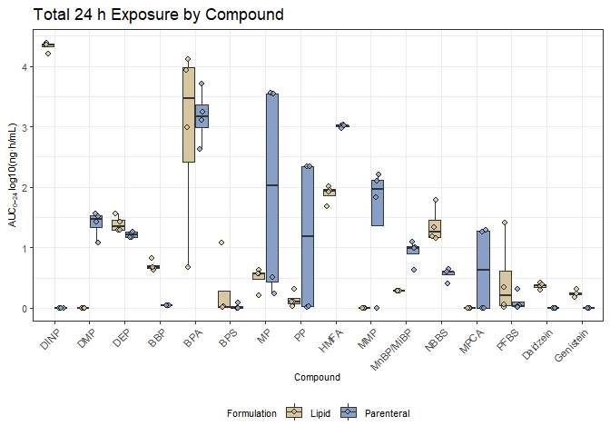<!-- -->

``` r
AUC_summary <- AUC_master %>% group_by(compound, type) %>% dplyr::mutate(min = min(value), max = max(value)) %>% ungroup() %>% as.data.frame()
AUC_summary <- AUC_summary %>% group_by(compound, type) %>% dplyr::slice(1L) %>% ungroup() %>% dplyr::select(compound, abbre, type, min, max, mean_AUC)

write.xlsx(AUC_summary, "D:/Michi/12_Plasticizer_Parenteral/Co_author_comments_03.26/Updated_Outputs/AUC_summary_19.03.26.xlsx")

head(AUC_summary)
```

    ## # A tibble: 6 × 6
    ##   compound             abbre type           min     max mean_AUC
    ##   <fct>                <chr> <chr>        <dbl>   <dbl>    <dbl>
    ## 1 Diisononyl phthalate DINP  Lipid      15839   24520    21575. 
    ## 2 Diisononyl phthalate DINP  Parenteral     0       0        0  
    ## 3 Dimethyl phthalate   DMP   Lipid          0       0        0  
    ## 4 Dimethyl phthalate   DMP   Parenteral    10.9    35.1     25.9
    ## 5 Diethyl phthalate    DEP   Lipid         18.4    34.9     24.4
    ## 6 Diethyl phthalate    DEP   Parenteral    13.8    17.3     15.4

``` r
rm(AUC_master, class_order, Boxplots_figure, compound_labs_x, i, j, k, AUC_summary)
```

## Time-dependent leaching kinetics for each compound across mixtures

``` r
dat_AUC_curve <- dat_AUC_subst
colnames(annot) <- c("Compound", "abbre", "class", "use")
dat_AUC_curve <- dat_AUC_curve %>% inner_join(annot, by = "Compound")

dat_AUC_curve$Compound <- factor(
  dat_AUC_curve$Compound,
  levels = compound_order$compound
)

dat_new <- dat_AUC_curve %>% group_by(Compound, abbre, type_infusion, timepoint) %>%
  summarise(mean_conc = mean(abundancy),
            sd_conc = sd(abundancy),
            .groups   = "drop")

compound_labs <- annot$abbre
names(compound_labs) <- annot$Compound

Time_kinetics <- ggplot() +
  geom_errorbar(data = dat_new,
                aes(x = timepoint,
                    ymin = mean_conc - sd_conc,
                    ymax = mean_conc + sd_conc,
                    color = type_infusion),
                linewidth = 0.3, width = 0.8, alpha = 0.7) +
  geom_point(data = dat_AUC_curve,
             aes(x = timepoint, y = abundancy, color = type_infusion),
             position = position_jitter(width = 0.3, height = 0),
             alpha = 0.4, size = 1) +  geom_point(data = dat_new,
                                                    aes(x = timepoint, y = mean_conc, color = type_infusion),
                                                    alpha = 1, size = 1.2) +
  geom_smooth(data = dat_AUC_curve,
              aes(x = timepoint, y = abundancy, color = type_infusion),
              method = "loess", se = FALSE, linetype = "solid", linewidth = 0.7, alpha = 0.7) +
  scale_fill_manual(values = c("Parenteral" = "#88A0C6", "Lipid" = "#D8C6A0")) +
  scale_color_manual(values = c("Parenteral" = "#6B85A0", "Lipid" = "#C2B08B")) +
  facet_wrap(~ Compound, scales = "free_y", ncol = 4, labeller = labeller(Compound = compound_labs)) +
  scale_x_continuous(breaks = c(0, 4, 12, 24)) +
  labs(
    x     = "Time (h)",
    y     = expression("Concentration (ng/mL)"),
    fill  = "Formulation",
    title = "Leaching over time"
  ) +
  theme_bw() +
  theme(
    strip.background = element_rect(fill = "gray95"),
    strip.text.x = element_text(size = 8, face = "bold"),
    legend.position  = "bottom",
    axis.text.y = element_text(size = 8),
    axis.text.x = element_text(size = 8),
    axis.title.x = element_text(size = 8),
    axis.title.y = element_text(size = 8),
    legend.text = element_text(size = 8),
    legend.title = element_text(size = 8)
  )

ggsave(
  filename = here::here("D:/Michi/12_Plasticizer_Parenteral/Co_author_comments_03.26/Updated_Plots/Time_kinetics.svg"),
  plot     = Time_kinetics,
  device   = svglite::svglite,
  width    = 17,
  height   = 13.5,
  units = "cm"
)
```

    ## Ignoring unknown labels:
    ## • fill : "Formulation"
    ## `geom_smooth()` using formula = 'y ~ x'

``` r
print(Time_kinetics)
```

    ## Ignoring unknown labels:
    ## • fill : "Formulation"
    ## `geom_smooth()` using formula = 'y ~ x'

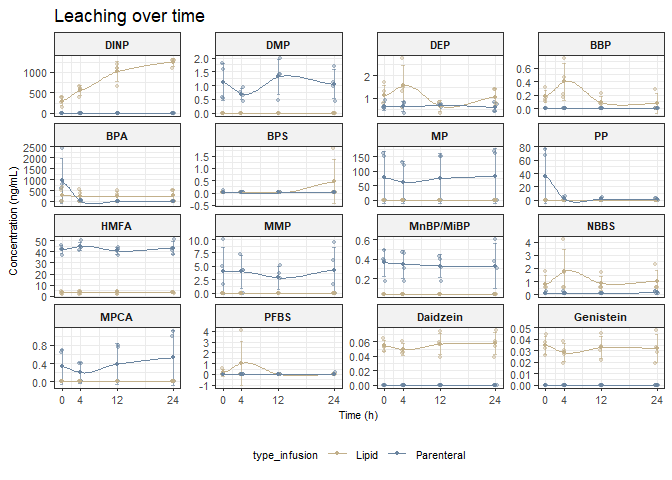<!-- -->

## Interpolation for model calculation

### DINP

``` r
# Exposure through lipid emulsion
dat_new_DINP_Lipid <- dat_new %>% dplyr::filter(abbre == "DINP" & type_infusion == "Lipid")
fit <- lm(mean_conc  ~ poly(timepoint , 2, raw = TRUE), data = dat_new_DINP_Lipid)
coefs <- coef(fit)

newdata <- data.frame(
  timepoint = seq(min(dat_new_DINP_Lipid$timepoint),
                  max(dat_new_DINP_Lipid$timepoint),
                  length.out = 100)
)

newdata$fit <- predict(fit, newdata = newdata)

eq <- paste0(
  "y = ", round(coefs[1], 1),
  ifelse(coefs[2] >= 0, " + ", " - "), abs(round(coefs[2], 2)), "*x",
  ifelse(coefs[3] >= 0, " + ", " - "), abs(round(coefs[3], 2)), "*x^2"
)


ggplot() +
  geom_point(data = dat_new_DINP_Lipid, aes(x = timepoint, y = mean_conc)) +
  geom_line(data = newdata, aes(x = timepoint, y = fit), color = "blue", size = 1) +
  annotate("text", 
           x = max(dat_new_DINP_Lipid$timepoint),
           y = max(dat_new_DINP_Lipid$mean_conc),
           label = eq,
           hjust = 2)
```

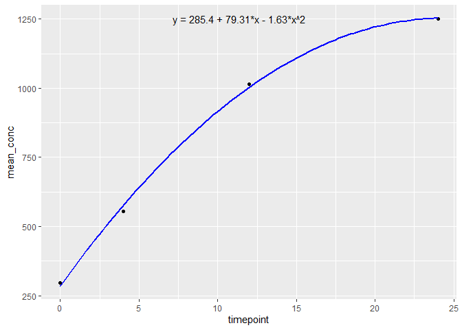<!-- -->

``` r
# Omit for Aqueous...no DINP in aqeuous solution
```

### BPA

``` r
# Hyperbolic decay function for aqueous data
dat_new_BPA_aq <- dat_new %>% dplyr::filter(abbre == "BPA" & type_infusion == "Parenteral")

# Pick Parameters
y0_start <- 5
c_start  <- 0.01

# Pick a start
idx <- which(dat_new_BPA_aq$timepoint > 0)[1]
x1  <- dat_new_BPA_aq$timepoint[idx]
y1  <- dat_new_BPA_aq$mean_conc[idx]

A_start <- (y1 - y0_start) * (x1 + c_start)

# Fit function
hyperbolic_decay <- nls(
  mean_conc ~ y0 + A / (timepoint + c),
  data = dat_new_BPA_aq,
  start = list(y0 = y0_start, A = A_start, c = c_start),
  control = nls.control(maxiter = 100)
)

coef(hyperbolic_decay)
```

    ##          y0           A           c 
    ##  -2.2006158 135.5294922   0.1442245

``` r
# Predict
newdata <- data.frame(
  timepoint = seq(min(dat_new_BPA_aq$timepoint), max(dat_new_BPA_aq$timepoint), length.out = 100)
)
newdata$fit <- predict(hyperbolic_decay, newdata)

coefs <- coef(hyperbolic_decay)
eq <- paste0("y = ", round(coefs["y0"],1),
             " + ", round(coefs["A"],1),
             "/(x + ", round(coefs["c"],3), ")")

ggplot(dat_new_BPA_aq, aes(timepoint, mean_conc)) +
  geom_point(size = 2) +
  geom_line(data = newdata, aes(y = fit), color = "blue", size = 1) +
  annotate("text",
           x = max(dat_new_BPA_aq$timepoint),
           y = max(dat_new_BPA_aq$mean_conc),
           label = eq,
           hjust = 1, vjust = 1) +
  theme_minimal() +
  labs(x = "Timepoint", y = "Mean concentration")
```

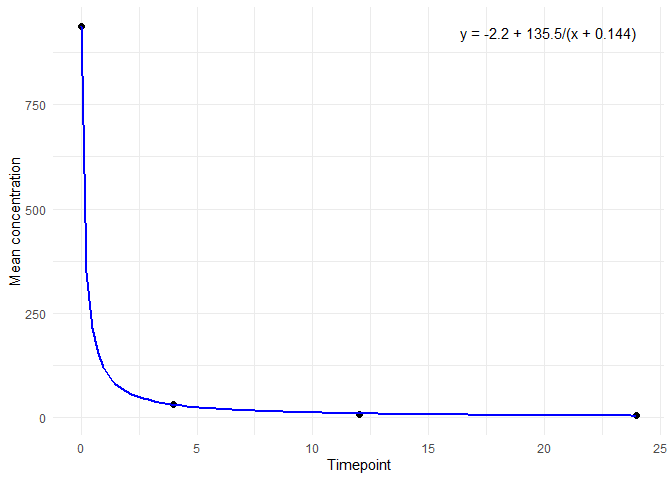<!-- -->

``` r
# Use mean for lipid data
dat_new_BPA_lip <- dat_new %>% dplyr::filter(abbre == "BPA" & type_infusion == "Lipid")
mean(dat_new_BPA_lip$mean_conc)
```

    ## [1] 245.04

# Clinical analysis

``` r
df <- readr::read_delim(
  "D:/Michi/12_Plasticizer_Parenteral/Revision_ES_and_T_0626/data_clinical/plast_invivo_jamnik.csv",
  delim = ";",
  locale = readr::locale(decimal_mark = ","),
  trim_ws = TRUE,
  show_col_types = FALSE,
  na = c("", "NA", "NaN")
) %>%
  filter(!is.na(id), !is.na(parenteral)) %>%
  mutate(
    parenteral = factor(parenteral, levels = c("no", "yes"),
                        labels = c("No(n=8)", "Yes(n=13)"))
  ) %>% dplyr::select(-DiBP)

exposure_vars <- df %>%
  select(where(is.numeric)) %>%
  select(-id, -parenteral_days) %>%
  names()

df_long <- df %>%
  pivot_longer(
    cols = all_of(exposure_vars),
    names_to = "exposure",
    values_to = "value"
  ) %>%
  filter(!is.na(value)) %>%
  mutate(exposure = factor(exposure, levels = exposure_vars))
```

## HMFA-related analysis

``` r
stat_df <- df_long %>%
  group_by(exposure) %>%
  wilcox_test(value ~ parenteral, exact = FALSE) %>%
  adjust_pvalue(method = "BH") %>%
  add_significance("p.adj") %>%
  add_xy_position(x = "parenteral", scales = "free_y") %>%
  mutate(label = paste0("adj.p =  ", signif(p.adj, 2)))

stat_df
```

    ## # A tibble: 5 × 15
    ##   exposure .y.   group1  group2      n1    n2 statistic     p p.adj p.adj.signif
    ##   <fct>    <chr> <chr>   <chr>    <int> <int>     <dbl> <dbl> <dbl> <chr>       
    ## 1 HMFA     value No(n=8) Yes(n=1…     8    13      12   0.002  0.01 **          
    ## 2 BBP      value No(n=8) Yes(n=1…     8    13      75   0.1    0.25 ns          
    ## 3 MEHP     value No(n=8) Yes(n=1…     8    13      46   0.69   0.69 ns          
    ## 4 BPA      value No(n=8) Yes(n=1…     8    13      44   0.587  0.69 ns          
    ## 5 NBBS     value No(n=8) Yes(n=1…     8    13      62.5 0.469  0.69 ns          
    ## # ℹ 5 more variables: y.position <dbl>, groups <named list>, xmin <dbl>,
    ## #   xmax <dbl>, label <chr>

``` r
stat_table_final <- stat_df %>%
  transmute(
    Analyte = exposure,
    `No Parenteral Nutrition` = n1,
    `Parenteral Nutrition` = n2,
    `Wilcoxon Statistic` = statistic,
    `P Value` = p,
    `Adjusted P Value` = p.adj
  ) %>%
  gt() %>%
  tab_header(
    title = md("**Xenobiotic Exposure According to Parenteral Nutrition**"),
    subtitle = "Wilcoxon rank-sum comparison"
  ) %>%
  cols_label(
    `No Parenteral Nutrition` = md("No Parenteral Nutrition<br>**N = 8**"),
    `Parenteral Nutrition` = md("Parenteral Nutrition<br>**N = 13**"),
    `P Value` = md("*P* Value"),
    `Adjusted P Value` = md("Adjusted *P* Value")
  ) %>%
  fmt_number(`Wilcoxon Statistic`, decimals = 1, drop_trailing_zeros = TRUE) %>%
  fmt(
    c(`P Value`, `Adjusted P Value`),
    fns = ~ ifelse(.x < 0.001, "<0.001", sprintf("%.3f", .x))
  ) %>%
  cols_align("left", Analyte) %>%
  cols_align("center", -Analyte) %>%
  tab_style(
    cell_text(weight = "bold"),
    cells_body(`Adjusted P Value`, rows = stat_df$p.adj < 0.05)
  ) %>%
  tab_source_note(
    md("Wilcoxon rank-sum test. *P* values were BH-corrected for multiple comparisons; adjusted *P*<0.05 was considered significant.")
  ) %>%
  tab_options(
    table.font.names = "Arial",
    table.font.size = px(11),
    column_labels.font.weight = "bold",
    column_labels.border.top.width = px(1.5),
    column_labels.border.bottom.width = px(1),
    table_body.border.bottom.width = px(1.5),
    table.border.left.width = px(0),
    table.border.right.width = px(0)
  )

stat_table_final
```

<div id="coxvprijkn" style="padding-left:0px;padding-right:0px;padding-top:10px;padding-bottom:10px;overflow-x:auto;overflow-y:auto;width:auto;height:auto;">

<table class="gt_table" data-quarto-disable-processing="false" data-quarto-bootstrap="false">
  <thead>
    <tr class="gt_heading">
      <td colspan="6" class="gt_heading gt_title gt_font_normal" style><span class='gt_from_md'><strong>Xenobiotic Exposure According to Parenteral Nutrition</strong></span></td>
    </tr>
    <tr class="gt_heading">
      <td colspan="6" class="gt_heading gt_subtitle gt_font_normal gt_bottom_border" style>Wilcoxon rank-sum comparison</td>
    </tr>
    <tr class="gt_col_headings">
      <th class="gt_col_heading gt_columns_bottom_border gt_left" rowspan="1" colspan="1" scope="col" id="Analyte">Analyte</th>
      <th class="gt_col_heading gt_columns_bottom_border gt_center" rowspan="1" colspan="1" scope="col" id="No-Parenteral-Nutrition"><span class='gt_from_md'>No Parenteral Nutrition<br><strong>N = 8</strong></span></th>
      <th class="gt_col_heading gt_columns_bottom_border gt_center" rowspan="1" colspan="1" scope="col" id="Parenteral-Nutrition"><span class='gt_from_md'>Parenteral Nutrition<br><strong>N = 13</strong></span></th>
      <th class="gt_col_heading gt_columns_bottom_border gt_center" rowspan="1" colspan="1" scope="col" id="Wilcoxon-Statistic">Wilcoxon Statistic</th>
      <th class="gt_col_heading gt_columns_bottom_border gt_center" rowspan="1" colspan="1" scope="col" id="P-Value"><span class='gt_from_md'><em>P</em> Value</span></th>
      <th class="gt_col_heading gt_columns_bottom_border gt_center" rowspan="1" colspan="1" scope="col" id="Adjusted-P-Value"><span class='gt_from_md'>Adjusted <em>P</em> Value</span></th>
    </tr>
  </thead>
  <tbody class="gt_table_body">
    <tr><td headers="Analyte" class="gt_row gt_left">HMFA</td>
<td headers="No Parenteral Nutrition" class="gt_row gt_center">8</td>
<td headers="Parenteral Nutrition" class="gt_row gt_center">13</td>
<td headers="Wilcoxon Statistic" class="gt_row gt_center">12</td>
<td headers="P Value" class="gt_row gt_center">0.002</td>
<td headers="Adjusted P Value" class="gt_row gt_center" style="font-weight: bold;">0.010</td></tr>
    <tr><td headers="Analyte" class="gt_row gt_left">BBP</td>
<td headers="No Parenteral Nutrition" class="gt_row gt_center">8</td>
<td headers="Parenteral Nutrition" class="gt_row gt_center">13</td>
<td headers="Wilcoxon Statistic" class="gt_row gt_center">75</td>
<td headers="P Value" class="gt_row gt_center">0.100</td>
<td headers="Adjusted P Value" class="gt_row gt_center">0.250</td></tr>
    <tr><td headers="Analyte" class="gt_row gt_left">MEHP</td>
<td headers="No Parenteral Nutrition" class="gt_row gt_center">8</td>
<td headers="Parenteral Nutrition" class="gt_row gt_center">13</td>
<td headers="Wilcoxon Statistic" class="gt_row gt_center">46</td>
<td headers="P Value" class="gt_row gt_center">0.690</td>
<td headers="Adjusted P Value" class="gt_row gt_center">0.690</td></tr>
    <tr><td headers="Analyte" class="gt_row gt_left">BPA</td>
<td headers="No Parenteral Nutrition" class="gt_row gt_center">8</td>
<td headers="Parenteral Nutrition" class="gt_row gt_center">13</td>
<td headers="Wilcoxon Statistic" class="gt_row gt_center">44</td>
<td headers="P Value" class="gt_row gt_center">0.587</td>
<td headers="Adjusted P Value" class="gt_row gt_center">0.690</td></tr>
    <tr><td headers="Analyte" class="gt_row gt_left">NBBS</td>
<td headers="No Parenteral Nutrition" class="gt_row gt_center">8</td>
<td headers="Parenteral Nutrition" class="gt_row gt_center">13</td>
<td headers="Wilcoxon Statistic" class="gt_row gt_center">62.5</td>
<td headers="P Value" class="gt_row gt_center">0.469</td>
<td headers="Adjusted P Value" class="gt_row gt_center">0.690</td></tr>
  </tbody>
  <tfoot>
    <tr class="gt_sourcenotes">
      <td class="gt_sourcenote" colspan="6"><span class='gt_from_md'>Wilcoxon rank-sum test. <em>P</em> values were BH-corrected for multiple comparisons; adjusted <em>P</em>&lt;0.05 was considered significant.</span></td>
    </tr>
  </tfoot>
</table>
</div>

``` r
gtsave(
  stat_table_final,
  filename = "Wilcoxon.docx",
  path = "D:/Michi/12_Plasticizer_Parenteral/ES & T_minor_revision_080926/outputs"
)


exposure_PN_strat <- ggplot(df_long, aes(x = parenteral, y = value, fill = parenteral)) +
  geom_boxplot(
    width = 0.55,
    outlier.shape = NA
  ) +
   geom_point(
    aes(col = parenteral),
    shape = 21,                   
    colour = "black",          
    stroke = 0.2, 
    position = position_jitterdodge(
      dodge.width = 0.8,
      jitter.width = 0.45
    ),
    size = 2,
    alpha = 0.8
  )  +
  scale_fill_manual(values = c("Yes(n=13)" = "#88A0C6", "No(n=8)" = "#D8C6A0")) +
  scale_color_manual(values = c("Yes(n=13)" = "#6B85A0", "No(n=8)" = "#C2B08B")) +
  stat_pvalue_manual(
    stat_df,
    label = "label",
    tip.length = 0.01,
    size = 3.4
  ) + scale_y_continuous(
    expand = expansion(mult = c(0.05, 0.25))
  ) +
  facet_wrap(~ exposure, scales = "free_y") +
  labs(
    x = "Parenteral nutrition during sampling",
    y = "Plasma concentration [ng/mL]",
    title = "Plasticizer exposure by parenteral yes/no group"
  ) +
  theme_bw() +
  theme(
    strip.background = element_rect(fill = "gray95"),
    strip.text.x = element_text(size = 8, face = "bold"),
    legend.position  = "right",
    axis.text.y = element_text(size = 8),
    axis.text.x = element_text(size = 8),
    axis.title.x = element_text(size = 8),
    axis.title.y = element_text(size = 8),
    legend.text = element_text(size = 8),
    legend.title = element_text(size = 8)
  )

ggsave(
  filename = here::here("D:/Michi/12_Plasticizer_Parenteral/ES & T_minor_revision_080926/outputs/exposure_PN_strat.svg"),
  plot     = exposure_PN_strat,
  device   = svglite::svglite,
  width    = 3,
  height   = 8.2,
  units = "cm"
)

print(exposure_PN_strat)
```

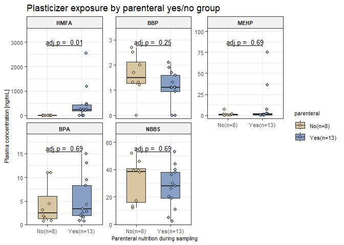<!-- -->

## Correlative analyses

``` r
df <- readr::read_delim(
   "D:/Michi/12_Plasticizer_Parenteral/Revision_ES_and_T_0626/data_clinical/plast_invivo_jamnik.csv",
  delim = ";",
  locale = readr::locale(decimal_mark = ","),
  trim_ws = TRUE,
  show_col_types = FALSE,
  na = c("", "NA", "NaN")
) %>%
  filter(!is.na(id)) %>%
  mutate(
    parenteral = factor(parenteral, levels = c("no", "yes"),
                        labels = c("No", "Yes"))
  ) %>% dplyr::select(-DiBP)

# Exposure columns only
df_longer <- df %>% pivot_longer(cols = c(2:6), names_to = "exposure", values_to = "value")

# Conversion of LOQ to LOD (taken from Jamnik et al. Supplement); no LOQ for MEHP
LOD <- c(
  HMFA = 150 * 3/10,
  NBBS = 1 * 3/10,
  BBP  = 0.66 * 3/10,
  BPA  = 0.57 * 3/10
)

# Replace 0 entries if value = 0 with the ones calculated above
df_longer <- df_longer %>%
  mutate(
    value = if_else(
      value == 0 & exposure %in% names(LOD),
      unname(LOD[as.character(exposure)]),
      value
    )
  ) %>% mutate(value_log10 = log10(value))

# filter
df_longer_only_par <- df_longer %>% dplyr::filter(parenteral == "Yes")
df_longer_all_data <- df_longer
```

### Processing of data

``` r
hmfa_df <- df_longer_only_par %>%
  filter(exposure == "HMFA") %>%
  select(id, HMFA = value, HMFA_log10 = value_log10)

corr_df <- df_longer_only_par %>%
  filter(exposure != "HMFA") %>%
  left_join(hmfa_df, by = "id") %>%
  filter(!is.na(value_log10), !is.na(HMFA_log10))
```

### Pearson correlation & table

``` r
stat_df <- corr_df %>%
  group_by(exposure) %>% 
  summarise(n = n(),
            r = cor(HMFA_log10,value_log10, method = "pearson"),
            p = cor.test(HMFA_log10,value_log10, method = "pearson")$p.value,
            .groups = "drop") %>% 
  mutate(p.adj = p.adjust(p, method = "BH"),
         signif = case_when(
      p.adj < 0.001 ~ "***",
      p.adj < 0.01  ~ "**",
      p.adj < 0.05  ~ "*",
      p.adj < 0.1   ~ ".",
      TRUE ~ "ns"
    ),
    label = paste0(
      "r = ", round(r, 2),
      "\nadj. p = ", signif(p.adj, 2),
      "\nn = ", n
    )
  )


stat_table_final <- stat_df %>%
  transmute(
    Analyte = exposure,
    N = n,
    `Pearson Correlation Coefficient` = r,
    `P Value` = p,
    `Adjusted P Value` = p.adj
  ) %>%
  gt() %>%
  tab_header(
    title = md("**Correlation of HMFA with Xenobiotics in Plasma**"),
    subtitle = "Infants receiving parenteral nutrition"
  ) %>%
  cols_label(
    `Pearson Correlation Coefficient` = md("Pearson Correlation<br>Coefficient (*r*)"),
    `P Value` = md("*P* Value"),
    `Adjusted P Value` = md("Adjusted *P* Value")
  ) %>%
  fmt_number(`Pearson Correlation Coefficient`, decimals = 2) %>%
  fmt(
    c(`P Value`, `Adjusted P Value`),
    fns = ~ ifelse(.x < 0.001, "<0.001", sprintf("%.3f", .x))
  ) %>%
  cols_align("left", Analyte) %>%
  cols_align("center", -Analyte) %>%
  tab_style(
    cell_text(weight = "bold"),
    cells_body(`Adjusted P Value`, rows = stat_df$p.adj < 0.05)
  ) %>%
  tab_source_note(
    md(
      "Pearson correlations were calculated using log10-transformed concentrations. \
*P* values were adjusted for multiple comparisons using the Benjamini–Hochberg method."
    )
  ) %>%
  tab_options(
    table.font.names = "Arial",
    table.font.size = px(11),
    column_labels.font.weight = "bold",
    column_labels.border.top.width = px(1.5),
    column_labels.border.bottom.width = px(1),
    table_body.border.bottom.width = px(1.5),
    table.border.left.width = px(0),
    table.border.right.width = px(0)
  )

stat_table_final
```

<div id="bawkuhhhjg" style="padding-left:0px;padding-right:0px;padding-top:10px;padding-bottom:10px;overflow-x:auto;overflow-y:auto;width:auto;height:auto;">

<table class="gt_table" data-quarto-disable-processing="false" data-quarto-bootstrap="false">
  <thead>
    <tr class="gt_heading">
      <td colspan="5" class="gt_heading gt_title gt_font_normal" style><span class='gt_from_md'><strong>Correlation of HMFA with Xenobiotics in Plasma</strong></span></td>
    </tr>
    <tr class="gt_heading">
      <td colspan="5" class="gt_heading gt_subtitle gt_font_normal gt_bottom_border" style>Infants receiving parenteral nutrition</td>
    </tr>
    <tr class="gt_col_headings">
      <th class="gt_col_heading gt_columns_bottom_border gt_left" rowspan="1" colspan="1" scope="col" id="Analyte">Analyte</th>
      <th class="gt_col_heading gt_columns_bottom_border gt_center" rowspan="1" colspan="1" scope="col" id="N">N</th>
      <th class="gt_col_heading gt_columns_bottom_border gt_center" rowspan="1" colspan="1" scope="col" id="Pearson-Correlation-Coefficient"><span class='gt_from_md'>Pearson Correlation<br>Coefficient (<em>r</em>)</span></th>
      <th class="gt_col_heading gt_columns_bottom_border gt_center" rowspan="1" colspan="1" scope="col" id="P-Value"><span class='gt_from_md'><em>P</em> Value</span></th>
      <th class="gt_col_heading gt_columns_bottom_border gt_center" rowspan="1" colspan="1" scope="col" id="Adjusted-P-Value"><span class='gt_from_md'>Adjusted <em>P</em> Value</span></th>
    </tr>
  </thead>
  <tbody class="gt_table_body">
    <tr><td headers="Analyte" class="gt_row gt_left">BBP</td>
<td headers="N" class="gt_row gt_center">13</td>
<td headers="Pearson Correlation Coefficient" class="gt_row gt_center">0.08</td>
<td headers="P Value" class="gt_row gt_center">0.798</td>
<td headers="Adjusted P Value" class="gt_row gt_center">0.798</td></tr>
    <tr><td headers="Analyte" class="gt_row gt_left">BPA</td>
<td headers="N" class="gt_row gt_center">13</td>
<td headers="Pearson Correlation Coefficient" class="gt_row gt_center">0.67</td>
<td headers="P Value" class="gt_row gt_center">0.012</td>
<td headers="Adjusted P Value" class="gt_row gt_center" style="font-weight: bold;">0.024</td></tr>
    <tr><td headers="Analyte" class="gt_row gt_left">MEHP</td>
<td headers="N" class="gt_row gt_center">13</td>
<td headers="Pearson Correlation Coefficient" class="gt_row gt_center">0.71</td>
<td headers="P Value" class="gt_row gt_center">0.006</td>
<td headers="Adjusted P Value" class="gt_row gt_center" style="font-weight: bold;">0.024</td></tr>
    <tr><td headers="Analyte" class="gt_row gt_left">NBBS</td>
<td headers="N" class="gt_row gt_center">13</td>
<td headers="Pearson Correlation Coefficient" class="gt_row gt_center">0.61</td>
<td headers="P Value" class="gt_row gt_center">0.026</td>
<td headers="Adjusted P Value" class="gt_row gt_center" style="font-weight: bold;">0.035</td></tr>
  </tbody>
  <tfoot>
    <tr class="gt_sourcenotes">
      <td class="gt_sourcenote" colspan="5"><span class='gt_from_md'>Pearson correlations were calculated using log10-transformed concentrations.
<em>P</em> values were adjusted for multiple comparisons using the Benjamini–Hochberg method.</span></td>
    </tr>
  </tfoot>
</table>
</div>

``` r
gtsave(
  stat_table_final,
  filename = "Pearson_only_parenteral.docx",
  path = "D:/Michi/12_Plasticizer_Parenteral/ES & T_minor_revision_080926/outputs"
)
```

### Figure

``` r
correlation_PN_pos <- ggplot(corr_df, aes(x = HMFA_log10, y = value_log10)) +
  geom_point(
    aes(fill = parenteral),
    shape = 21,
    colour = "black",
    stroke = 0.2,
    size = 2,
    alpha = 0.85
  ) +
  geom_smooth(
    method = "lm",
    se = TRUE,
    linewidth = 0.6
  ) +
  geom_text(
    data = stat_df,
    aes(x = -Inf, y = Inf, label = label),
    inherit.aes = FALSE,
    hjust = -0.05,
    vjust = 1.15,
    size = 2.7
  ) +
  facet_wrap(~ exposure, scales = "free_y") +
  scale_fill_manual(values = c("Yes" = "#88A0C6", "No" = "#D8C6A0")) +
  labs(
    x = "HMFA - Plasma concentration [log10(ng/mL)]",
    y = "Plasma concentration [log10(ng/mL)]",
    fill = "Parenteral nutrition",
    title = "Correlation of HMFA with other plasticizer exposures"
  ) +
  theme_bw() +
  theme(
    strip.background = element_rect(fill = "gray95"),
    strip.text.x = element_text(size = 8, face = "bold"),
    legend.position  = "right",
    axis.text.y = element_text(size = 8),
    axis.text.x = element_text(size = 8),
    axis.title.x = element_text(size = 8),
    axis.title.y = element_text(size = 8),
    legend.text = element_text(size = 8),
    legend.title = element_text(size = 8),
    plot.title = element_text(size = 9, face = "bold")
  )

ggsave(
  filename = here::here("D:/Michi/12_Plasticizer_Parenteral/ES & T_minor_revision_080926/outputs/correlation_PN_pos.svg"),
  plot     = correlation_PN_pos,
  device   = svglite::svglite,
  width    = 11,
  height   = 9.1,
  units = "cm"
)
```

    ## `geom_smooth()` using formula = 'y ~ x'

``` r
print(correlation_PN_pos)
```

    ## `geom_smooth()` using formula = 'y ~ x'

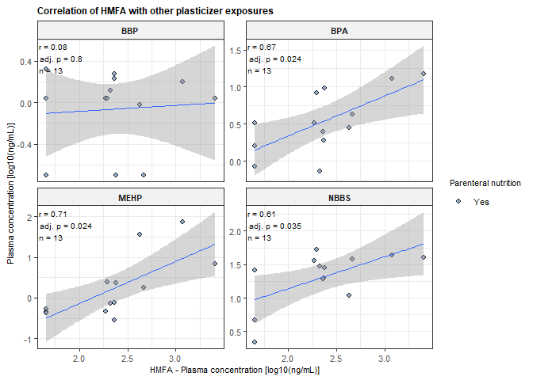<!-- -->

## Sensitivity analysis including all infants

### Processing

``` r
hmfa_df <- df_longer_all_data %>%
  filter(exposure == "HMFA") %>%
  select(id, HMFA = value, HMFA_log10 = value_log10)

corr_df <- df_longer_all_data %>%
  filter(exposure != "HMFA") %>%
  left_join(hmfa_df, by = "id") %>%
  filter(!is.na(value_log10), !is.na(HMFA_log10))
```

### Pearson correlation & table

``` r
stat_df <- corr_df %>%
  group_by(exposure) %>% 
  summarise(n = n(),
            r = cor(HMFA_log10, value_log10, method = "pearson"),
            p = cor.test(HMFA_log10, value_log10, method = "pearson")$p.value,
            .groups = "drop") %>% 
  mutate(p.adj = p.adjust(p, method = "BH"),
         signif = case_when(
      p.adj < 0.001 ~ "***",
      p.adj < 0.01  ~ "**",
      p.adj < 0.05  ~ "*",
      p.adj < 0.1   ~ ".",
      TRUE ~ "ns"
    ),
    label = paste0(
      "r = ", round(r, 2),
      "\nadj. p = ", signif(p.adj, 2),
      "\nn = ", n
    )
  )


stat_table_final <- stat_df %>%
  transmute(
    Analyte = exposure,
    N = n,
    `Pearson Correlation Coefficient` = r,
    `P Value` = p,
    `Adjusted P Value` = p.adj
  ) %>%
  gt() %>%
  tab_header(
    title = md("**Correlation of HMFA with Xenobiotics in Plasma**"),
    subtitle = "Whole cohort"
  ) %>%
  cols_label(
    `Pearson Correlation Coefficient` = md("Pearson Correlation<br>Coefficient (*r*)"),
    `P Value` = md("*P* Value"),
    `Adjusted P Value` = md("Adjusted *P* Value")
  ) %>%
  fmt_number(`Pearson Correlation Coefficient`, decimals = 2) %>%
  fmt(
    c(`P Value`, `Adjusted P Value`),
    fns = ~ ifelse(.x < 0.001, "<0.001", sprintf("%.3f", .x))
  ) %>%
  cols_align("left", Analyte) %>%
  cols_align("center", -Analyte) %>%
  tab_style(
    cell_text(weight = "bold"),
    cells_body(`Adjusted P Value`, rows = stat_df$p.adj < 0.05)
  ) %>%
  tab_source_note(
    md(
      "Pearson correlations were calculated using log10-transformed plasma concentrations. *P* values were adjusted for multiple comparisons using the Benjamini–Hochberg method."
    )
  ) %>%
  tab_options(
    table.font.names = "Arial",
    table.font.size = px(11),
    column_labels.font.weight = "bold",
    column_labels.border.top.width = px(1.5),
    column_labels.border.bottom.width = px(1),
    table_body.border.bottom.width = px(1.5),
    table.border.left.width = px(0),
    table.border.right.width = px(0)
  )

stat_table_final
```

<div id="dlwdjnijly" style="padding-left:0px;padding-right:0px;padding-top:10px;padding-bottom:10px;overflow-x:auto;overflow-y:auto;width:auto;height:auto;">

<table class="gt_table" data-quarto-disable-processing="false" data-quarto-bootstrap="false">
  <thead>
    <tr class="gt_heading">
      <td colspan="5" class="gt_heading gt_title gt_font_normal" style><span class='gt_from_md'><strong>Correlation of HMFA with Xenobiotics in Plasma</strong></span></td>
    </tr>
    <tr class="gt_heading">
      <td colspan="5" class="gt_heading gt_subtitle gt_font_normal gt_bottom_border" style>Whole cohort</td>
    </tr>
    <tr class="gt_col_headings">
      <th class="gt_col_heading gt_columns_bottom_border gt_left" rowspan="1" colspan="1" scope="col" id="Analyte">Analyte</th>
      <th class="gt_col_heading gt_columns_bottom_border gt_center" rowspan="1" colspan="1" scope="col" id="N">N</th>
      <th class="gt_col_heading gt_columns_bottom_border gt_center" rowspan="1" colspan="1" scope="col" id="Pearson-Correlation-Coefficient"><span class='gt_from_md'>Pearson Correlation<br>Coefficient (<em>r</em>)</span></th>
      <th class="gt_col_heading gt_columns_bottom_border gt_center" rowspan="1" colspan="1" scope="col" id="P-Value"><span class='gt_from_md'><em>P</em> Value</span></th>
      <th class="gt_col_heading gt_columns_bottom_border gt_center" rowspan="1" colspan="1" scope="col" id="Adjusted-P-Value"><span class='gt_from_md'>Adjusted <em>P</em> Value</span></th>
    </tr>
  </thead>
  <tbody class="gt_table_body">
    <tr><td headers="Analyte" class="gt_row gt_left">BBP</td>
<td headers="N" class="gt_row gt_center">21</td>
<td headers="Pearson Correlation Coefficient" class="gt_row gt_center">−0.11</td>
<td headers="P Value" class="gt_row gt_center">0.623</td>
<td headers="Adjusted P Value" class="gt_row gt_center">0.623</td></tr>
    <tr><td headers="Analyte" class="gt_row gt_left">BPA</td>
<td headers="N" class="gt_row gt_center">21</td>
<td headers="Pearson Correlation Coefficient" class="gt_row gt_center">0.47</td>
<td headers="P Value" class="gt_row gt_center">0.032</td>
<td headers="Adjusted P Value" class="gt_row gt_center">0.064</td></tr>
    <tr><td headers="Analyte" class="gt_row gt_left">MEHP</td>
<td headers="N" class="gt_row gt_center">21</td>
<td headers="Pearson Correlation Coefficient" class="gt_row gt_center">0.60</td>
<td headers="P Value" class="gt_row gt_center">0.004</td>
<td headers="Adjusted P Value" class="gt_row gt_center" style="font-weight: bold;">0.016</td></tr>
    <tr><td headers="Analyte" class="gt_row gt_left">NBBS</td>
<td headers="N" class="gt_row gt_center">21</td>
<td headers="Pearson Correlation Coefficient" class="gt_row gt_center">0.29</td>
<td headers="P Value" class="gt_row gt_center">0.208</td>
<td headers="Adjusted P Value" class="gt_row gt_center">0.277</td></tr>
  </tbody>
  <tfoot>
    <tr class="gt_sourcenotes">
      <td class="gt_sourcenote" colspan="5"><span class='gt_from_md'>Pearson correlations were calculated using log10-transformed plasma concentrations. <em>P</em> values were adjusted for multiple comparisons using the Benjamini–Hochberg method.</span></td>
    </tr>
  </tfoot>
</table>
</div>

``` r
gtsave(
  stat_table_final,
  filename = "Pearson_all_children.docx",
  path = "D:/Michi/12_Plasticizer_Parenteral/ES & T_minor_revision_080926/outputs"
)
```

### Figure

``` r
correlation_PN_all <- ggplot(corr_df, aes(x = HMFA_log10, y = value_log10)) +
  geom_point(
    aes(fill = parenteral),
    shape = 21,
    colour = "black",
    stroke = 0.2,
    size = 2,
    alpha = 0.85
  ) +
  geom_smooth(
    method = "lm",
    se = TRUE,
    linewidth = 0.6
  ) +
  geom_text(
    data = stat_df,
    aes(x = -Inf, y = Inf, label = label),
    inherit.aes = FALSE,
    hjust = -0.05,
    vjust = 1.15,
    size = 2.7
  ) +
  facet_wrap(~ exposure, scales = "free_y") +
  scale_fill_manual(values = c("Yes" = "#88A0C6", "No" = "#D8C6A0")) +
  labs(
    x = "HMFA - Plasma concentration [log10(ng/mL)]",
    y = "Plasma concentration [log10(ng/mL)]",
    fill = "Parenteral nutrition",
    title = "Correlation of HMFA with other plasticizer exposures"
  ) +
  theme_bw() +
  theme(
    strip.background = element_rect(fill = "gray95"),
    strip.text.x = element_text(size = 8, face = "bold"),
    legend.position  = "right",
    axis.text.y = element_text(size = 8),
    axis.text.x = element_text(size = 8),
    axis.title.x = element_text(size = 8),
    axis.title.y = element_text(size = 8),
    legend.text = element_text(size = 8),
    legend.title = element_text(size = 8),
    plot.title = element_text(size = 9, face = "bold")
  )

ggsave(
  filename = here::here("D:/Michi/12_Plasticizer_Parenteral/ES & T_minor_revision_080926/outputs/correlation_PN_all.svg"),
  plot     = correlation_PN_all,
  device   = svglite::svglite,
  width    = 11.2,
  height   = 9.1,
  units = "cm"
)
```

    ## `geom_smooth()` using formula = 'y ~ x'

``` r
print(correlation_PN_all)
```

    ## `geom_smooth()` using formula = 'y ~ x'

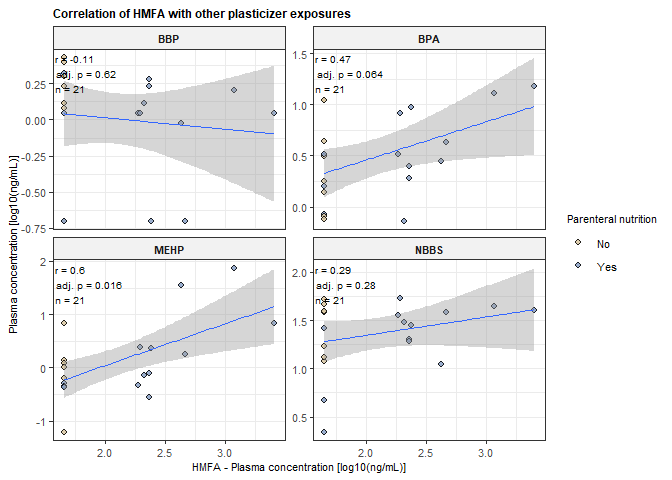<!-- -->

## Additional clinical variables

``` r
new_dat <- rio::import("D:/Michi/12_Plasticizer_Parenteral/ES & T_minor_revision_080926/analyses/plast_invivo_jamnik_new_data.csv") %>% select(id, vent, prbc_3days, parenteral_days, parenteral, gender, GA, GW, BW, Apg5, Apg10, BPD, NEC, ROP, days_MV, days_cpap, days_HFNC, total_transfusion) %>% mutate_at(c(2,3,5,6,10:14), as.character) %>% mutate_at(c(2,3,5,6,10:14), as.factor) %>% mutate_at(c(1), as.character) %>% mutate_at(c(4,8,9,15:18), as.character) %>% mutate_at(c(4,8,9,15:18), as.numeric)

new_dat_sens_analysis_vector <- new_dat %>% dplyr::filter(prbc_3days == "yes")
new_dat_sens_analysis_vector <- new_dat_sens_analysis_vector$id %>% unique()

new_dat <- new_dat %>% dplyr::select(-parenteral_days, - prbc_3days)
```

### Sensitivity analysis: TF within 3d excluded from parenteral group; table + figure

``` r
df <- readr::read_delim(
  "D:/Michi/12_Plasticizer_Parenteral/Revision_ES_and_T_0626/data_clinical/plast_invivo_jamnik.csv",
  delim = ";",
  locale = readr::locale(decimal_mark = ","),
  trim_ws = TRUE,
  show_col_types = FALSE,
  na = c("", "NA", "NaN")
) %>%
  filter(!is.na(id), !is.na(parenteral)) %>%
  mutate(
    parenteral = factor(parenteral, levels = c("no", "yes"),
                        labels = c("No(n=8)", "Yes(n=13)"))
  ) %>% dplyr::select(-DiBP) %>% mutate_at(c(1), as.character)

df <- df %>%
  dplyr::filter(!id %in% new_dat_sens_analysis_vector) %>% mutate_at(c(1), as.numeric)

exposure_vars <- df %>%
  select(where(is.numeric)) %>%
  select(-id, -parenteral_days) %>%
  names()

df_long <- df %>%
  pivot_longer(
    cols = all_of(exposure_vars),
    names_to = "exposure",
    values_to = "value"
  ) %>%
  filter(!is.na(value)) %>%
  mutate(exposure = factor(exposure, levels = exposure_vars))

stat_df <- df_long %>%
  group_by(exposure) %>%
  wilcox_test(value ~ parenteral, exact = FALSE) %>%
  adjust_pvalue(method = "BH") %>%
  add_significance("p.adj") %>%
  add_xy_position(x = "parenteral", scales = "free_y") %>%
  mutate(label = paste0("adj.p =  ", signif(p.adj, 2)))


stat_table_final <- stat_df %>%
  transmute(
    Analyte = exposure,
    `No Parenteral Nutrition` = n1,
    `Parenteral Nutrition` = n2,
    `Wilcoxon Statistic` = statistic,
    `P Value` = p,
    `Adjusted P Value` = p.adj
  ) %>%
  gt() %>%
  tab_header(
    title = md(
      "**Sensitivity analysis of xenobiotic exposure according to parenteral nutrition**"
    ),
    subtitle = md(
      "Excluding infants who received packed red blood cell transfusion within 3 days before sampling"
    )
  ) %>%
  cols_label(
    Analyte = md("Analyte"),
    `No Parenteral Nutrition` = md("No Parenteral Nutrition, *n*"),
    `Parenteral Nutrition` = md("Parenteral Nutrition, *n*"),
    `Wilcoxon Statistic` = md("Wilcoxon Statistic"),
    `P Value` = md("*P* Value"),
    `Adjusted P Value` = md("Adjusted *P* Value")
  ) %>%
  fmt_number(
    `Wilcoxon Statistic`,
    decimals = 1,
    drop_trailing_zeros = TRUE
  ) %>%
  fmt(
    c(`P Value`, `Adjusted P Value`),
    fns = ~ ifelse(.x < 0.001, "<0.001", sprintf("%.3f", .x))
  ) %>%
  cols_align("left", Analyte) %>%
  cols_align("center", -Analyte) %>%
  tab_style(
    cell_text(weight = "bold"),
    cells_body(
      `Adjusted P Value`,
      rows = `Adjusted P Value` < 0.05
    )
  ) %>%
  tab_source_note(
    md(
      paste0(
        "Sensitivity analysis excluding infants who received packed red blood cell ",
        "(pRBC) transfusion within 3 days before sampling. ",
        "Xenobiotic concentrations were compared between infants receiving and not receiving ",
        "parenteral nutrition using the Wilcoxon rank-sum test. ",
        "*P* values were adjusted across the five tested xenobiotics using the ",
        "Benjamini–Hochberg (BH) procedure; adjusted *P* < 0.05 was considered significant."
      )
    )
  ) %>%
  tab_options(
    table.font.names = "Arial",
    table.font.size = px(11),
    column_labels.font.weight = "bold",
    column_labels.border.top.width = px(1.5),
    column_labels.border.bottom.width = px(1),
    table_body.border.bottom.width = px(1.5),
    table.border.left.width = px(0),
    table.border.right.width = px(0)
  )

stat_table_final
```

<div id="csxsinkkzw" style="padding-left:0px;padding-right:0px;padding-top:10px;padding-bottom:10px;overflow-x:auto;overflow-y:auto;width:auto;height:auto;">

<table class="gt_table" data-quarto-disable-processing="false" data-quarto-bootstrap="false">
  <thead>
    <tr class="gt_heading">
      <td colspan="6" class="gt_heading gt_title gt_font_normal" style><span class='gt_from_md'><strong>Sensitivity analysis of xenobiotic exposure according to parenteral nutrition</strong></span></td>
    </tr>
    <tr class="gt_heading">
      <td colspan="6" class="gt_heading gt_subtitle gt_font_normal gt_bottom_border" style><span class='gt_from_md'>Excluding infants who received packed red blood cell transfusion within 3 days before sampling</span></td>
    </tr>
    <tr class="gt_col_headings">
      <th class="gt_col_heading gt_columns_bottom_border gt_left" rowspan="1" colspan="1" scope="col" id="Analyte"><span class='gt_from_md'>Analyte</span></th>
      <th class="gt_col_heading gt_columns_bottom_border gt_center" rowspan="1" colspan="1" scope="col" id="No-Parenteral-Nutrition"><span class='gt_from_md'>No Parenteral Nutrition, <em>n</em></span></th>
      <th class="gt_col_heading gt_columns_bottom_border gt_center" rowspan="1" colspan="1" scope="col" id="Parenteral-Nutrition"><span class='gt_from_md'>Parenteral Nutrition, <em>n</em></span></th>
      <th class="gt_col_heading gt_columns_bottom_border gt_center" rowspan="1" colspan="1" scope="col" id="Wilcoxon-Statistic"><span class='gt_from_md'>Wilcoxon Statistic</span></th>
      <th class="gt_col_heading gt_columns_bottom_border gt_center" rowspan="1" colspan="1" scope="col" id="P-Value"><span class='gt_from_md'><em>P</em> Value</span></th>
      <th class="gt_col_heading gt_columns_bottom_border gt_center" rowspan="1" colspan="1" scope="col" id="Adjusted-P-Value"><span class='gt_from_md'>Adjusted <em>P</em> Value</span></th>
    </tr>
  </thead>
  <tbody class="gt_table_body">
    <tr><td headers="Analyte" class="gt_row gt_left">HMFA</td>
<td headers="No Parenteral Nutrition" class="gt_row gt_center">8</td>
<td headers="Parenteral Nutrition" class="gt_row gt_center">7</td>
<td headers="Wilcoxon Statistic" class="gt_row gt_center">8</td>
<td headers="P Value" class="gt_row gt_center">0.007</td>
<td headers="Adjusted P Value" class="gt_row gt_center" style="font-weight: bold;">0.036</td></tr>
    <tr><td headers="Analyte" class="gt_row gt_left">BBP</td>
<td headers="No Parenteral Nutrition" class="gt_row gt_center">8</td>
<td headers="Parenteral Nutrition" class="gt_row gt_center">7</td>
<td headers="Wilcoxon Statistic" class="gt_row gt_center">40.5</td>
<td headers="P Value" class="gt_row gt_center">0.163</td>
<td headers="Adjusted P Value" class="gt_row gt_center">0.408</td></tr>
    <tr><td headers="Analyte" class="gt_row gt_left">MEHP</td>
<td headers="No Parenteral Nutrition" class="gt_row gt_center">8</td>
<td headers="Parenteral Nutrition" class="gt_row gt_center">7</td>
<td headers="Wilcoxon Statistic" class="gt_row gt_center">27</td>
<td headers="P Value" class="gt_row gt_center">0.954</td>
<td headers="Adjusted P Value" class="gt_row gt_center">0.954</td></tr>
    <tr><td headers="Analyte" class="gt_row gt_left">BPA</td>
<td headers="No Parenteral Nutrition" class="gt_row gt_center">8</td>
<td headers="Parenteral Nutrition" class="gt_row gt_center">7</td>
<td headers="Wilcoxon Statistic" class="gt_row gt_center">23</td>
<td headers="P Value" class="gt_row gt_center">0.602</td>
<td headers="Adjusted P Value" class="gt_row gt_center">0.752</td></tr>
    <tr><td headers="Analyte" class="gt_row gt_left">NBBS</td>
<td headers="No Parenteral Nutrition" class="gt_row gt_center">8</td>
<td headers="Parenteral Nutrition" class="gt_row gt_center">7</td>
<td headers="Wilcoxon Statistic" class="gt_row gt_center">37.5</td>
<td headers="P Value" class="gt_row gt_center">0.297</td>
<td headers="Adjusted P Value" class="gt_row gt_center">0.495</td></tr>
  </tbody>
  <tfoot>
    <tr class="gt_sourcenotes">
      <td class="gt_sourcenote" colspan="6"><span class='gt_from_md'>Sensitivity analysis excluding infants who received packed red blood cell (pRBC) transfusion within 3 days before sampling. Xenobiotic concentrations were compared between infants receiving and not receiving parenteral nutrition using the Wilcoxon rank-sum test. <em>P</em> values were adjusted across the five tested xenobiotics using the Benjamini–Hochberg (BH) procedure; adjusted <em>P</em> &lt; 0.05 was considered significant.</span></td>
    </tr>
  </tfoot>
</table>
</div>

``` r
gtsave(
  stat_table_final,
  filename = "Infants_no_pRBC.docx",
  path = "D:/Michi/12_Plasticizer_Parenteral/ES & T_minor_revision_080926/outputs"
)

exposure_PN_strat <- ggplot(df_long, aes(x = parenteral, y = value, fill = parenteral)) +
  geom_boxplot(
    width = 0.55,
    outlier.shape = NA
  ) +
   geom_point(
    aes(col = parenteral),
    shape = 21,                   
    colour = "black",          
    stroke = 0.2, 
    position = position_jitterdodge(
      dodge.width = 0.8,
      jitter.width = 0.45
    ),
    size = 2,
    alpha = 0.8
  )  +
  scale_fill_manual(values = c("Yes(n=13)" = "#88A0C6", "No(n=8)" = "#D8C6A0")) +
  scale_color_manual(values = c("Yes(n=13)" = "#6B85A0", "No(n=8)" = "#C2B08B")) +
  stat_pvalue_manual(
    stat_df,
    label = "label",
    tip.length = 0.01,
    size = 3.4
  ) + scale_y_continuous(
    expand = expansion(mult = c(0.05, 0.25))
  ) +
  facet_wrap(~ exposure, scales = "free_y") +
  labs(
    x = "Parenteral nutrition during sampling",
    y = "Plasma concentration [ng/mL]",
    title = "Plasticizer exposure by parenteral yes/no group"
  ) +
  theme_bw() +
  theme(
    strip.background = element_rect(fill = "gray95"),
    strip.text.x = element_text(size = 8, face = "bold"),
    legend.position  = "right",
    axis.text.y = element_text(size = 8),
    axis.text.x = element_text(size = 8),
    axis.title.x = element_text(size = 8),
    axis.title.y = element_text(size = 8),
    legend.text = element_text(size = 8),
    legend.title = element_text(size = 8)
  )

print(exposure_PN_strat)
```

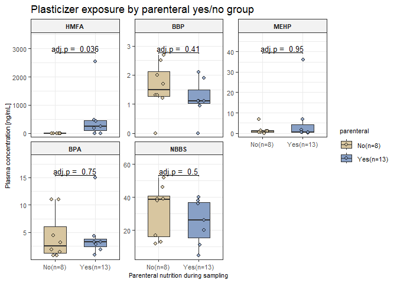<!-- -->

### Table: Clinical characteristics of the cohort at hand

``` r
df <- new_dat %>%
  mutate(
    GA_weeks = as.numeric(sub("\\+.*", "", GA)), GA_days = as.numeric(sub(".*\\+", "", GA)), GA_weeks_num = (GA_weeks + (GA_days/7))) %>% mutate_at(c(8,9), as.character) %>% mutate_at(c(8,9), as.numeric)

n_no  <- sum(df$parenteral == "no", na.rm = TRUE)
n_yes <- sum(df$parenteral == "yes", na.rm = TRUE)

clinical_df <- df %>%
  group_by(parenteral) %>%
  summarise(
    `Sex (male/female)` = paste0(
      sum(gender == "M", na.rm = TRUE), "/",
      sum(gender == "F", na.rm = TRUE)
    ),

    `Gestational age (weeks)` = paste0(
      round(mean(GA_weeks_num, na.rm = TRUE), 1), " ± ",
      round(sd(GA_weeks_num, na.rm = TRUE), 1)
    ),

    `Birth weight (g)` = paste0(
      round(mean(BW, na.rm = TRUE), 0), " ± ",
      round(sd(BW, na.rm = TRUE), 0)
    ),

    `APGAR score at min 5 (min–max)` = paste0(
      min(Apg5, na.rm = TRUE), "–",
      max(Apg5, na.rm = TRUE)
    ),

    `APGAR score at min 10 (min–max)` = paste0(
      min(Apg10, na.rm = TRUE), "–",
      max(Apg10, na.rm = TRUE)
    ),

    `Retinopathy of prematurity (%)` = paste0(
      round(mean(ROP == "Yes", na.rm = TRUE) * 100, 1), "%"
    ),

    `Bronchopulmonary dysplasia (%)` = paste0(
      round(mean(BPD == "Yes", na.rm = TRUE) * 100, 1), "%"
    ),

    `Necrotizing enterocolitis (%)` = paste0(
      round(mean(NEC == "Yes", na.rm = TRUE) * 100, 1), "%"
    ),

    `Total number of pRBC transfusions (mean / min - max)` = paste0(
     round(mean(total_transfusion, na.rm = TRUE), 0), " / ",
     min(total_transfusion, na.rm = TRUE), "–",
      max(total_transfusion, na.rm = TRUE)
    ),

    `Respiratory support at sampling (%)` = paste0(
  "MV:\u00A0", round(mean(vent == "MV", na.rm = TRUE) * 100, 1), "%",
  "\u00A0\u00A0|\u00A0\u00A0",
  "nCPAP:\u00A0", round(mean(vent == "nCPAP", na.rm = TRUE) * 100, 1), "%",
  "\u00A0\u00A0|\u00A0\u00A0",
  "HFNC:\u00A0", round(mean(vent == "HFNC", na.rm = TRUE) * 100, 1), "%"
),
    .groups = "drop") %>%
  pivot_longer(
    cols = -parenteral,
    names_to = "Characteristic",
    values_to = "Value"
  ) %>%
  pivot_wider(
    names_from = parenteral,
    values_from = Value
  )

clinical_table_final <- clinical_df %>%
  transmute(
    Characteristic = Characteristic,
    `No Parenteral Nutrition` = no,
    `Parenteral Nutrition` = yes
  ) %>%
  gt() %>%
  tab_header(
    title = md("**Clinical Characteristics According to Parenteral Nutrition**")
  ) %>%
  cols_label(
    Characteristic = "",
    `No Parenteral Nutrition` = md(
      paste0("**No Parenteral Nutrition**<br>(n = ", n_no, ")")
    ),
    `Parenteral Nutrition` = md(
      paste0("**Parenteral Nutrition**<br>(n = ", n_yes, ")")
    )
  ) %>%
  cols_align("left", Characteristic) %>%
  cols_align(
    "center",
    c(`No Parenteral Nutrition`, `Parenteral Nutrition`)
  )  %>%
  tab_source_note(
    md(
      "Data are presented as mean ± SD unless otherwise indicated. APGAR scores are presented as minimum–maximum; sex as male/female counts; categorical variables as percentages."
    )
  ) %>%
  tab_source_note(
    md(
      "**Abbreviations:** HFNC, high-flow nasal cannula; MV, mechanical ventilation; nCPAP, nasal continuous positive airway pressure; pRBC, packed red blood cells."
    )
  ) %>%
  cols_width(
  Characteristic ~ px(330),
  `No Parenteral Nutrition` ~ px(400),
  `Parenteral Nutrition` ~ px(400)
) %>%
tab_options(
  table.width = px(1130),
  table.font.names = "Arial",
  table.font.size = px(11),
  column_labels.font.weight = "bold",
  column_labels.border.top.width = px(1.5),
  column_labels.border.bottom.width = px(1),
  table_body.border.bottom.width = px(1.5),
  table.border.left.width = px(0),
  table.border.right.width = px(0)
)

clinical_table_final
```

<div id="tpsdrchshl" style="padding-left:0px;padding-right:0px;padding-top:10px;padding-bottom:10px;overflow-x:auto;overflow-y:auto;width:auto;height:auto;">

<table class="gt_table" style="table-layout:fixed;width:1130px;" data-quarto-disable-processing="false" data-quarto-bootstrap="false">
  <colgroup>
    <col style="width:330px;"/>
    <col style="width:400px;"/>
    <col style="width:400px;"/>
  </colgroup>
  <thead>
    <tr class="gt_heading">
      <td colspan="3" class="gt_heading gt_title gt_font_normal gt_bottom_border" style><span class='gt_from_md'><strong>Clinical Characteristics According to Parenteral Nutrition</strong></span></td>
    </tr>
    &#10;    <tr class="gt_col_headings">
      <th class="gt_col_heading gt_columns_bottom_border gt_left" rowspan="1" colspan="1" scope="col" id="Characteristic"></th>
      <th class="gt_col_heading gt_columns_bottom_border gt_center" rowspan="1" colspan="1" scope="col" id="No-Parenteral-Nutrition"><span class='gt_from_md'><strong>No Parenteral Nutrition</strong><br>(n = 8)</span></th>
      <th class="gt_col_heading gt_columns_bottom_border gt_center" rowspan="1" colspan="1" scope="col" id="Parenteral-Nutrition"><span class='gt_from_md'><strong>Parenteral Nutrition</strong><br>(n = 13)</span></th>
    </tr>
  </thead>
  <tbody class="gt_table_body">
    <tr><td headers="Characteristic" class="gt_row gt_left">Sex (male/female)</td>
<td headers="No Parenteral Nutrition" class="gt_row gt_center">4/4</td>
<td headers="Parenteral Nutrition" class="gt_row gt_center">7/6</td></tr>
    <tr><td headers="Characteristic" class="gt_row gt_left">Gestational age (weeks)</td>
<td headers="No Parenteral Nutrition" class="gt_row gt_center">26.2 ± 0.9</td>
<td headers="Parenteral Nutrition" class="gt_row gt_center">25.7 ± 1.4</td></tr>
    <tr><td headers="Characteristic" class="gt_row gt_left">Birth weight (g)</td>
<td headers="No Parenteral Nutrition" class="gt_row gt_center">774 ± 109</td>
<td headers="Parenteral Nutrition" class="gt_row gt_center">787 ± 178</td></tr>
    <tr><td headers="Characteristic" class="gt_row gt_left">APGAR score at min 5 (min–max)</td>
<td headers="No Parenteral Nutrition" class="gt_row gt_center">4–9</td>
<td headers="Parenteral Nutrition" class="gt_row gt_center">7–9</td></tr>
    <tr><td headers="Characteristic" class="gt_row gt_left">APGAR score at min 10 (min–max)</td>
<td headers="No Parenteral Nutrition" class="gt_row gt_center">4–9</td>
<td headers="Parenteral Nutrition" class="gt_row gt_center">9–9</td></tr>
    <tr><td headers="Characteristic" class="gt_row gt_left">Retinopathy of prematurity (%)</td>
<td headers="No Parenteral Nutrition" class="gt_row gt_center">37.5%</td>
<td headers="Parenteral Nutrition" class="gt_row gt_center">61.5%</td></tr>
    <tr><td headers="Characteristic" class="gt_row gt_left">Bronchopulmonary dysplasia (%)</td>
<td headers="No Parenteral Nutrition" class="gt_row gt_center">25%</td>
<td headers="Parenteral Nutrition" class="gt_row gt_center">46.2%</td></tr>
    <tr><td headers="Characteristic" class="gt_row gt_left">Necrotizing enterocolitis (%)</td>
<td headers="No Parenteral Nutrition" class="gt_row gt_center">0%</td>
<td headers="Parenteral Nutrition" class="gt_row gt_center">15.4%</td></tr>
    <tr><td headers="Characteristic" class="gt_row gt_left">Total number of pRBC transfusions (mean / min - max)</td>
<td headers="No Parenteral Nutrition" class="gt_row gt_center">2 / 0–4</td>
<td headers="Parenteral Nutrition" class="gt_row gt_center">8 / 2–16</td></tr>
    <tr><td headers="Characteristic" class="gt_row gt_left">Respiratory support at sampling (%)</td>
<td headers="No Parenteral Nutrition" class="gt_row gt_center">MV: 0%  |  nCPAP: 37.5%  |  HFNC: 62.5%</td>
<td headers="Parenteral Nutrition" class="gt_row gt_center">MV: 15.4%  |  nCPAP: 61.5%  |  HFNC: 23.1%</td></tr>
  </tbody>
  <tfoot>
    <tr class="gt_sourcenotes">
      <td class="gt_sourcenote" colspan="3"><span class='gt_from_md'>Data are presented as mean ± SD unless otherwise indicated. APGAR scores are presented as minimum–maximum; sex as male/female counts; categorical variables as percentages.</span></td>
    </tr>
    <tr class="gt_sourcenotes">
      <td class="gt_sourcenote" colspan="3"><span class='gt_from_md'><strong>Abbreviations:</strong> HFNC, high-flow nasal cannula; MV, mechanical ventilation; nCPAP, nasal continuous positive airway pressure; pRBC, packed red blood cells.</span></td>
    </tr>
  </tfoot>
</table>
</div>

``` r
gtsave(
  clinical_table_final,
  filename = "clinical_table_final.docx",
  path = "D:/Michi/12_Plasticizer_Parenteral/ES & T_minor_revision_080926/outputs"
)
```

# RNAseq analysis

## High temporal resolution mouse data

### Import data and metadata

``` r
library(edgeR)
library(ComplexHeatmap)
library(grr)
```

    ## 
    ## Attache Paket: 'grr'

    ## Das folgende Objekt ist maskiert 'package:gt':
    ## 
    ##     matches

    ## Das folgende Objekt ist maskiert 'package:dplyr':
    ## 
    ##     matches

    ## Die folgenden Objekte sind maskiert von 'package:tidyr':
    ## 
    ##     extract, matches

``` r
library("orthogene")
library(circlize)
pacman::p_load(SummarizedExperiment)
library(ComplexHeatmap)
library(biomaRt)

RNAseq <- rio::import(here::here("data", "RNA_seq_data.xlsx"))
rownames(RNAseq) <- NULL
RNAseq <- RNAseq %>%
  column_to_rownames(var = "Gene Symbol") %>% mutate_at(c(1:36), as.numeric)


metadata2 <- rio::import(here::here("data", "RNA_seq_metadata.xlsx"))
```

    ## New names:
    ## • `` -> `...1`

``` r
rownames(metadata2) <- NULL
metadata2 <- metadata2 %>%
  column_to_rownames(var = "...1")
metadata2 <- metadata2 %>% t() %>% as.data.frame() %>% rownames_to_column(var = "Sample_ID") %>% mutate_at(c(2,3), as.factor) 

RNAseq <- RNAseq[, metadata2$Sample_ID] 
```

### Orthologous gene mapping

``` r
ortho_list <- orthogene::convert_orthologs(
  gene_df         = as.matrix(RNAseq),
  gene_input      = "rownames", 
  gene_output     = "rownames", 
  input_species   = "mouse",
  output_species  = "human",
  non121_strategy = "keep_both_species",
  method          = "babelgene",
  agg_fun  = "mean",
)

gene_df <- as.data.frame(as.matrix(ortho_list))
gene_df <- gene_df %>% as.data.frame() %>% rownames_to_column(var = "GENEID")

vec <- gene_df$GENEID %>% unique()
n_samples <- ncol(gene_df) - 1

gene_df <- gene_df %>%
  filter(rowSums(dplyr::select(., -GENEID) != 0) > 0.75 * n_samples)
```

### Subset data

``` r
# Search for relevant classes
phaseI_classes <- c("CYP", "ADH", "ALDH", "FMO", "CES", "EPHX", "MAO", "AKR", "XDH", "NQO", "POR")
phaseII_classes <- c("UGT", "SULT", "GST", "NAT", "COMT", "TPMT")

phase_I <- vec[grep(paste0("^(", paste(phaseI_classes, collapse = "|"), ")"), vec)]
phase_II <- vec[grep(paste0("^(", paste(phaseII_classes, collapse = "|"), ")"), vec)]

# Annotate identified genes
phaseI_df <- tibble(GENEID = vec) %>%
  filter(str_detect(GENEID, paste0("^(", paste(phaseI_classes, collapse = "|"), ")"))) %>%
  mutate(
    Class = str_extract(GENEID, paste0("^(", paste(phaseI_classes, collapse = "|"), ")")),
    Phase = "Phase I"
  )

phaseII_df <- tibble(GENEID = vec) %>%
  filter(str_detect(GENEID, paste0("^(", paste(phaseII_classes, collapse = "|"), ")"))) %>%
  mutate(
    Class = str_extract(GENEID, paste0("^(", paste(phaseII_classes, collapse = "|"), ")")),
    Phase = "Phase II"
  )

# Filter ortholog-matched dataframe
Relevant_Genes <- rbind(phaseI_df, phaseII_df)
Relevant_Genes <- Relevant_Genes %>% left_join(gene_df, by = "GENEID") %>% na.omit()

# Imputation
Relevant_Genes_filled <- Relevant_Genes %>%
  rowwise() %>%
  mutate(across(-c(1:3), ~ ifelse(. == 0, min(c_across(-c(1:3))[c_across(-c(1:3)) != 0])/2, .))) %>%
  ungroup()

Relevant_Genes_filled <- Relevant_Genes_filled %>% mutate_at(c(1:3), as.factor)

# Log(2) transform the data
Relevant_Genes_filled_counts <- Relevant_Genes_filled %>% column_to_rownames(var = "GENEID")  %>% dplyr::select(c(3:38)) %>% mutate(across(everything(), ~ log2(.)))
```

### Heatmap

``` r
# Take log2 transformed FPKM values as input data and scale
htmp_dat <- Relevant_Genes_filled_counts %>% t() %>%  scale() %>% t()
PhaseI_genes <- Relevant_Genes %>% filter(Phase == "Phase I") %>% pull(GENEID)
PhaseII_genes <- Relevant_Genes %>% filter(Phase == "Phase II") %>% pull(GENEID)
htmp_metadata <- metadata2

row_split_vector <- ifelse(rownames(htmp_dat) %in% PhaseI_genes, "Phase I",
                           ifelse(rownames(htmp_dat) %in% PhaseII_genes, "Phase II", NA))

col_an = HeatmapAnnotation(Timepoint = htmp_metadata$Day, 
                           col = list(Timepoint = c(
                             "D-2"  = "#FFFDD0",
                             "D0"   = "#FFF3B8",
                             "D1"   = "#FFE9A0",
                             "D3"   = "#FFD589",
                             "D5"   = "#FFBF73",
                             "D10"  = "#FFAB5E",
                             "D15"  = "#FF9366",
                             "D20"  = "#E57661",
                             "D25"  = "#C95A5D",
                             "D30"  = "#B04259",
                             "D45"  = "#9C2B55",
                             "D60"  = "#7A274E"
                           )),  height = unit(0.5, "cm") )

col_fun_2 <- colorRamp2(c(-2, 0, 2), c("#0765A0", "#FFF1E4","#c61700"))
lgd = Legend(col_fun = col_fun_2, title = "z-score")


Htmp_manuscript <- Heatmap(htmp_dat, show_row_names = TRUE, show_row_dend = TRUE, col = col_fun_2, cluster_columns = FALSE,show_column_names = FALSE,
                    clustering_method_columns = "complete", clustering_method_rows = "complete", column_dend_side = "top",  column_title_gp = gpar(fontsize = 8) , 
                    row_split = row_split_vector, row_gap = unit(8, "mm"),row_names_gp = gpar(fontsize = 0), row_dend_width = unit(0.5, "cm"),   
                    column_dend_height = unit(0.5, "cm"), top_annotation = col_an, name = "z-factor")

graph2svg(Htmp_manuscript, here("Figures", "Htmp_manuscript.svg"), width = 4, height = 5)
```

    ## Exported graph as D:/Michi/12_Plasticizer_Parenteral/Figures/Htmp_manuscript.svg

``` r
print(Htmp_manuscript)
```

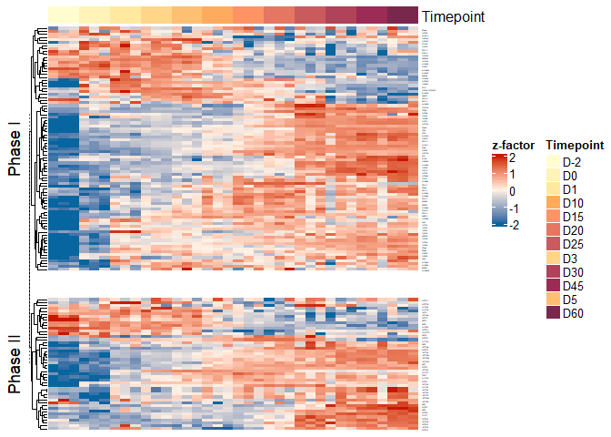<!-- -->

### Longitudinal expression trajectory of gene-families

``` r
metadata_join <- metadata2 %>% 
  mutate(timepoint = case_when(grepl("D-2", Day) ~ "-2",
                             grepl("D10", Day) ~"10",
                             grepl("D15", Day) ~"15",
                             grepl("D20", Day) ~"20",
                             grepl("D25", Day) ~"25",
                             grepl("D30", Day) ~"30",
                             grepl("D45", Day) ~"45",
                             grepl("D60", Day) ~"60",
                             grepl("D0", Day) ~"0",
                             grepl("D1", Day) ~ "1",
                             grepl("D3", Day) ~"3",
                             grepl("D5", Day) ~"5")) %>% dplyr::select(Sample_ID, Replicate, timepoint)
metadata_join$timepoint <- as.factor(metadata_join$timepoint)

# take "raw FPKM values" as input data; not log2 transformed data used in heatmap
Relevant_Genes_filled_longer <- Relevant_Genes_filled %>% pivot_longer(cols = c(4:39), names_to = "Sample_ID", values_to = "expression") %>% left_join(metadata_join, by = "Sample_ID")
Relevant_Genes_filled_longer <- Relevant_Genes_filled_longer %>% group_by(GENEID, timepoint) %>% mutate(Gene_exp_per_tp = sum(expression)) %>% ungroup()
Relevant_Genes_filled_longer <- Relevant_Genes_filled_longer %>% group_by(GENEID) %>% mutate(Gene_exp_across_all_tp = sum(expression)) %>% ungroup()
Relevant_Genes_filled_longer_slice <- Relevant_Genes_filled_longer %>% mutate(Fraction_GENE_TP = ((Gene_exp_per_tp/Gene_exp_across_all_tp)*100)) %>% 
  group_by(GENEID, timepoint) %>% dplyr::slice(1L) %>% ungroup()

Relevant_Genes_filled_longer_slice$timepoint <- as.character(Relevant_Genes_filled_longer_slice$timepoint)
Relevant_Genes_filled_longer_slice$timepoint <- as.numeric(Relevant_Genes_filled_longer_slice$timepoint)

dat_new <- Relevant_Genes_filled_longer_slice %>% group_by(Class, timepoint) %>%
  summarise(mean_conc = mean(Fraction_GENE_TP),
            se_conc   = sd(Fraction_GENE_TP) / sqrt(n()),
            .groups   = "drop")

# add metadata
join_df <- Relevant_Genes_filled_longer_slice %>% dplyr::select(Class, Phase) %>% group_by(Class, Phase) %>% dplyr::slice(1L) %>% ungroup()
dat_new <- dat_new %>% left_join(join_df, by = "Class") %>% dplyr::select(Class, Phase, timepoint, mean_conc, se_conc)

# Filter
dat_new <- dat_new %>% subset(Class %in% c("CYP", "ADH", "AKR", "UGT", "GST", "SULT", "CES"))
```

### Plotting cumulative gene expression trajectories

``` r
Phase_metabolis_kinetics <- ggplot() +
  geom_errorbar(data = dat_new,
                aes(x = timepoint,
                    ymin = mean_conc - se_conc,
                    ymax = mean_conc + se_conc,
                    color = Phase),
                linewidth = 0.4, width = 1, alpha = 0.6) +
  geom_point(data = dat_new,aes(x = timepoint, y = mean_conc, color = Phase),alpha = 1, size = 0.7) +
  geom_smooth(data = dat_new,
              aes(x = timepoint, y = mean_conc, color = Phase),
              method = "loess", se = FALSE, linetype = "solid", linewidth = 0.8, alpha = 0.7) +
  scale_fill_manual(values = c("Phase I" = "#88A0C6", "Phase II" = "#D8C6A0")) +
  scale_color_manual(values = c("Phase I" = "#6B85A0", "Phase II" = "#C2B08B")) +
  facet_wrap(~ Class, scales = "free_y", ncol = 3) +
  scale_x_continuous(breaks = c(-2,0, 5, 10, 20, 30, 40, 50,60)) +
  labs(
    x     = "Time (days)",
    y     = expression("% of cumulative expression"),
    fill  = "Formulation"
  ) +
  theme_bw() +
  theme(
    strip.background = element_rect(fill = "gray95"),
    strip.text.x = element_text(size = 8, face = "bold"),
    legend.position  = "bottom",
    axis.text.y = element_text(size = 8),
    axis.text.x = element_text(size = 8),
    axis.title.x = element_text(size = 8),
    axis.title.y = element_text(size = 8),       
    legend.text = element_text(size = 8),
    legend.title = element_text(size = 8),
  )

graph2svg(Phase_metabolis_kinetics, here("Figures", "Phase_metabolis_kinetics.svg"), width = 4.7, height = 3.7)
```

    ## Ignoring unknown labels:
    ## • fill : "Formulation"
    ## `geom_smooth()` using formula = 'y ~ x'
    ## Exported graph as D:/Michi/12_Plasticizer_Parenteral/Figures/Phase_metabolis_kinetics.svg

``` r
print(Phase_metabolis_kinetics)
```

    ## Ignoring unknown labels:
    ## • fill : "Formulation"
    ## `geom_smooth()` using formula = 'y ~ x'

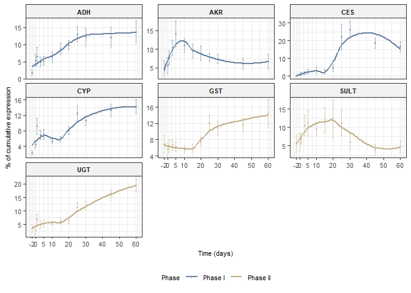<!-- -->

## Cross-species comparisons

### Load & prepare the data (Human)

``` r
# Load
library(AnnotationDbi)
```

    ## 
    ## Attache Paket: 'AnnotationDbi'

    ## Das folgende Objekt ist maskiert 'package:rstatix':
    ## 
    ##     select

    ## Das folgende Objekt ist maskiert 'package:MASS':
    ## 
    ##     select

    ## Das folgende Objekt ist maskiert 'package:clusterProfiler':
    ## 
    ##     select

    ## Das folgende Objekt ist maskiert 'package:dplyr':
    ## 
    ##     select

``` r
library(org.Hs.eg.db)
```

    ## 

``` r
library(org.Mm.eg.db)
```

    ## 

``` r
library(org.Rn.eg.db)
```

    ## 

``` r
library(org.Mmu.eg.db)
```

    ## 

``` r
# Load data
x <- rio::import(here::here("data/RNA_seq_species_comp", "Human.txt"))
x <- x[, c(TRUE, grepl("liver", colnames(x)[-1], ignore.case = TRUE))] %>% dplyr::rename("ensembl_gene_id" = "V1")

sum(grepl("\\.[0-9]+$", x$ensembl_gene_id))
```

    ## [1] 0

``` r
x %>%
  dplyr::count(ensembl_gene_id) %>%
  dplyr::filter(n > 1)
```

    ## [1] ensembl_gene_id n              
    ## <0 Zeilen> (oder row.names mit Länge 0)

``` r
# all stripped off the version numbers
mapping <- AnnotationDbi::select(
  org.Hs.eg.db,
  keys = unique(x$ensembl_gene_id),
  keytype = "ENSEMBL",
  columns = "SYMBOL"
) %>%
  dplyr::rename(
    ensembl_gene_id = ENSEMBL,
    hgnc_symbol = SYMBOL
  )
```

    ## 'select()' returned 1:many mapping between keys and columns

``` r
mapping <- mapping %>% dplyr::filter(
    !is.na(hgnc_symbol),
    hgnc_symbol != ""
  )

mapping_clear <- mapping %>% distinct(hgnc_symbol, ensembl_gene_id) %>% 
  dplyr::group_by(ensembl_gene_id) %>%
  dplyr::filter(dplyr::n_distinct(hgnc_symbol) == 1) %>%
  dplyr::ungroup()

x <- x %>%
  left_join(mapping_clear, by = "ensembl_gene_id") %>% 
  dplyr::filter(
    !is.na(hgnc_symbol),
    hgnc_symbol != "") %>% dplyr::group_by(hgnc_symbol) %>%
  dplyr::summarise(dplyr::across(where(is.numeric),~ mean(.x, na.rm = TRUE)), .groups = "drop")

n_samples <- ncol(x) - 1
Human <- x %>%
  filter(rowSums(dplyr::select(., -hgnc_symbol) != 0, na.rm = TRUE) > 0.75 * n_samples)

Human <- Human %>% rename("GENEID" = "hgnc_symbol")

rm(x, n_samples, mapping, mapping_clear)
```

### Load & prepare the data (Mouse data)

``` r
# Load data
x <- rio::import(here::here("data/RNA_seq_species_comp", "Mouse.txt"))
x <- x[, c(TRUE, grepl("liver", colnames(x)[-1], ignore.case = TRUE))] %>% dplyr::rename("ensembl_gene_id" = "V1")


sum(grepl("\\.[0-9]+$", x$ensembl_gene_id))
```

    ## [1] 0

``` r
x %>%
  dplyr::count(ensembl_gene_id) %>%
  dplyr::filter(n > 1)
```

    ## [1] ensembl_gene_id n              
    ## <0 Zeilen> (oder row.names mit Länge 0)

``` r
# all stripped off the version numbers
mapping <- AnnotationDbi::select(
  org.Mm.eg.db,
  keys = unique(x$ensembl_gene_id),
  keytype = "ENSEMBL",
  columns = "SYMBOL"
) %>%
  dplyr::rename(
    ensembl_gene_id = ENSEMBL,
    hgnc_symbol = SYMBOL
  )

mapping <- mapping %>% dplyr::filter(
    !is.na(hgnc_symbol),
    hgnc_symbol != ""
  )

mapping_clear <- mapping %>% distinct(hgnc_symbol, ensembl_gene_id) %>% 
  dplyr::group_by(ensembl_gene_id) %>%
  dplyr::filter(dplyr::n_distinct(hgnc_symbol) == 1) %>%
  dplyr::ungroup()

Mouse <- x %>%
  left_join(mapping_clear, by = "ensembl_gene_id") %>% 
  dplyr::filter(
    !is.na(hgnc_symbol),
    hgnc_symbol != "") %>% dplyr::group_by(hgnc_symbol) %>%
  dplyr::summarise(dplyr::across(where(is.numeric),~ mean(.x, na.rm = TRUE)), .groups = "drop")

rm(x, mapping, mapping_clear)

Mouse <- Mouse %>% column_to_rownames(var = "hgnc_symbol")

#Ortholog mapping 
ortho_list <- orthogene::convert_orthologs(
  gene_df         = as.matrix(Mouse),
  gene_input      = "rownames", 
  gene_output     = "rownames", 
  input_species   = "mouse",
  output_species  = "human",
  non121_strategy = "keep_both_species",
  method          = "babelgene",
  agg_fun  = "mean"
)

Mouse <- as.data.frame(as.matrix(ortho_list))
Mouse <- Mouse %>% as.data.frame() %>% rownames_to_column(var = "GENEID")

n_samples <- ncol(Mouse) - 1
Mouse <- Mouse %>%
  filter(rowSums(dplyr::select(., -GENEID) != 0, na.rm = TRUE) > 0.75 * n_samples)

rm(n_samples, ortho_list)
```

### Load & prepare the data (Rat data)

``` r
# Load data
x <- rio::import(here::here("data/RNA_seq_species_comp", "Rat.txt"))
x <- x[, c(TRUE, grepl("liver", colnames(x)[-1], ignore.case = TRUE))] %>% dplyr::rename("ensembl_gene_id" = "V1")

sum(grepl("\\.[0-9]+$", x$ensembl_gene_id))
```

    ## [1] 0

``` r
x %>%
  dplyr::count(ensembl_gene_id) %>%
  dplyr::filter(n > 1)
```

    ## [1] ensembl_gene_id n              
    ## <0 Zeilen> (oder row.names mit Länge 0)

``` r
# all stripped off the version numbers
mapping <- AnnotationDbi::select(
  org.Rn.eg.db,
  keys = unique(x$ensembl_gene_id),
  keytype = "ENSEMBL",
  columns = "SYMBOL"
) %>%
  dplyr::rename(
    ensembl_gene_id = ENSEMBL,
    hgnc_symbol = SYMBOL
  )

mapping <- mapping %>% dplyr::filter(
    !is.na(hgnc_symbol),
    hgnc_symbol != ""
  )

mapping_clear <- mapping %>% distinct(hgnc_symbol, ensembl_gene_id) %>% 
  dplyr::group_by(ensembl_gene_id) %>%
  dplyr::filter(dplyr::n_distinct(hgnc_symbol) == 1) %>%
  dplyr::ungroup()

Rat <- x %>%
  left_join(mapping_clear, by = "ensembl_gene_id") %>% 
  dplyr::filter(
    !is.na(hgnc_symbol),
    hgnc_symbol != "") %>% dplyr::group_by(hgnc_symbol) %>%
  dplyr::summarise(dplyr::across(where(is.numeric),~ mean(.x, na.rm = TRUE)), .groups = "drop")

rm(x, mapping, mapping_clear)

Rat <- Rat %>% column_to_rownames(var = "hgnc_symbol")

#Ortholog mapping 
ortho_list <- orthogene::convert_orthologs(
  gene_df         = as.matrix(Rat),
  gene_input      = "rownames", 
  gene_output     = "rownames", 
  input_species   = "rat",
  output_species  = "human",
  non121_strategy = "keep_both_species",
  method          = "babelgene",
  agg_fun  = "mean"
)

Rat <- as.data.frame(as.matrix(ortho_list))
Rat <- Rat %>% as.data.frame() %>% rownames_to_column(var = "GENEID")

n_samples <- ncol(Rat) - 1
Rat <- Rat %>%
  filter(rowSums(dplyr::select(., -GENEID) != 0, na.rm = TRUE) > 0.75 * n_samples)

rm(n_samples, ortho_list)
```

### Load & prepare the data (Rhesus macaque)

``` r
# Load data
x <- rio::import(here::here("data/RNA_seq_species_comp", "Rhesus.txt"))
x <- x[, c(TRUE, grepl("liver", colnames(x)[-1], ignore.case = TRUE))] %>% dplyr::rename("ensembl_gene_id" = "V1")

sum(grepl("\\.[0-9]+$", x$ensembl_gene_id))
```

    ## [1] 0

``` r
x %>%
  dplyr::count(ensembl_gene_id) %>%
  dplyr::filter(n > 1)
```

    ## [1] ensembl_gene_id n              
    ## <0 Zeilen> (oder row.names mit Länge 0)

``` r
# all stripped off the version numbers
mapping <- AnnotationDbi::select(
  org.Mmu.eg.db,
  keys = unique(x$ensembl_gene_id),
  keytype = "ENSEMBL",
  columns = "SYMBOL"
) %>%
  dplyr::rename(
    ensembl_gene_id = ENSEMBL,
    hgnc_symbol = SYMBOL
  )

mapping <- mapping %>% dplyr::filter(
    !is.na(hgnc_symbol),
    hgnc_symbol != ""
  )

mapping_clear <- mapping %>% distinct(hgnc_symbol, ensembl_gene_id) %>% 
  dplyr::group_by(ensembl_gene_id) %>%
  dplyr::filter(dplyr::n_distinct(hgnc_symbol) == 1) %>%
  dplyr::ungroup()

Rhesus <- x %>%
  left_join(mapping_clear, by = "ensembl_gene_id") %>% 
  dplyr::filter(
    !is.na(hgnc_symbol),
    hgnc_symbol != "") %>% dplyr::group_by(hgnc_symbol) %>%
  dplyr::summarise(dplyr::across(where(is.numeric),~ mean(.x, na.rm = TRUE)), .groups = "drop")


rm(x, mapping, mapping_clear)

Rhesus <- Rhesus %>% column_to_rownames(var = "hgnc_symbol")

#Ortholog mapping 
ortho_list <- orthogene::convert_orthologs(
  gene_df         = as.matrix(Rhesus),
  gene_input      = "rownames", 
  gene_output     = "rownames", 
  input_species   = "Macaca mulatta",
  output_species  = "human",
  non121_strategy = "keep_both_species",
  method          = "babelgene",
  agg_fun  = "mean"
)

Rhesus <- as.data.frame(as.matrix(ortho_list))
Rhesus <- Rhesus %>% as.data.frame() %>% rownames_to_column(var = "GENEID")

n_samples <- ncol(Rhesus) - 1
Rhesus <- Rhesus %>%
  filter(rowSums(dplyr::select(., -GENEID) != 0, na.rm = TRUE) > 0.75 * n_samples)

rm(n_samples, ortho_list)
```

### Filter relevant genes

``` r
phaseI_classes <- c("CYP", "ADH", "ALDH", "FMO", "CES", "EPHX", "MAO", "AKR", "XDH", "NQO", "POR")
phaseII_classes <- c("UGT", "SULT", "GST", "NAT", "COMT", "TPMT")

# Remove pseudogenes or wrongfully included genes that otherwise may be retained
remove_genes <- c("FMOD", "PORCN", "GSTCD", "NAT10", "NAT14", "NAT8L", "NAT9", "CYP2D8P", "CYP4F26P", "ALDH7A1P1", "NATD1", "UGT8", "ALDH16A1")

# Use on Human
vec <- Human$GENEID %>% unique()

phaseI_df <- tibble(GENEID = vec) %>%
  filter(str_detect(GENEID, paste0("^(", paste(phaseI_classes, collapse = "|"), ")"))) %>%
  mutate(
    Class = str_extract(GENEID, paste0("^(", paste(phaseI_classes, collapse = "|"), ")")),
    Phase = "Phase I"
  )

phaseII_df <- tibble(GENEID = vec) %>%
  filter(str_detect(GENEID, paste0("^(", paste(phaseII_classes, collapse = "|"), ")"))) %>%
  mutate(
    Class = str_extract(GENEID, paste0("^(", paste(phaseII_classes, collapse = "|"), ")")),
    Phase = "Phase II"
  )
Relevant_Genes_human <- rbind(phaseI_df, phaseII_df)

Relevant_Genes_human <- Relevant_Genes_human %>%
  dplyr::filter(!GENEID %in% remove_genes)

Human_relevant <- Relevant_Genes_human %>% left_join(Human, by = "GENEID") %>% na.omit()


#Use on Mouse
vec <- Mouse$GENEID %>% unique()

phaseI_df <- tibble(GENEID = vec) %>%
  filter(str_detect(GENEID, paste0("^(", paste(phaseI_classes, collapse = "|"), ")"))) %>%
  mutate(
    Class = str_extract(GENEID, paste0("^(", paste(phaseI_classes, collapse = "|"), ")")),
    Phase = "Phase I"
  )

phaseII_df <- tibble(GENEID = vec) %>%
  filter(str_detect(GENEID, paste0("^(", paste(phaseII_classes, collapse = "|"), ")"))) %>%
  mutate(
    Class = str_extract(GENEID, paste0("^(", paste(phaseII_classes, collapse = "|"), ")")),
    Phase = "Phase II"
  )
Relevant_Genes_mouse <- rbind(phaseI_df, phaseII_df)

Relevant_Genes_mouse <- Relevant_Genes_mouse %>%
  dplyr::filter(!GENEID %in% remove_genes)

Mouse_relevant <- Relevant_Genes_mouse %>% left_join(Mouse, by = "GENEID") %>% na.omit()

#Use on Rhesus
vec <- Rhesus$GENEID %>% unique()

phaseI_df <- tibble(GENEID = vec) %>%
  filter(str_detect(GENEID, paste0("^(", paste(phaseI_classes, collapse = "|"), ")"))) %>%
  mutate(
    Class = str_extract(GENEID, paste0("^(", paste(phaseI_classes, collapse = "|"), ")")),
    Phase = "Phase I"
  )

phaseII_df <- tibble(GENEID = vec) %>%
  filter(str_detect(GENEID, paste0("^(", paste(phaseII_classes, collapse = "|"), ")"))) %>%
  mutate(
    Class = str_extract(GENEID, paste0("^(", paste(phaseII_classes, collapse = "|"), ")")),
    Phase = "Phase II"
  )
Relevant_Genes_rhesus <- rbind(phaseI_df, phaseII_df)

Relevant_Genes_rhesus <- Relevant_Genes_rhesus %>%
  dplyr::filter(!GENEID %in% remove_genes)

Rhesus_relevant <- Relevant_Genes_rhesus %>% left_join(Rhesus, by = "GENEID") %>% na.omit()


# Use on rat
vec <- Rat$GENEID %>% unique()


phaseI_df <- tibble(GENEID = vec) %>%
  filter(str_detect(GENEID, paste0("^(", paste(phaseI_classes, collapse = "|"), ")"))) %>%
  mutate(
    Class = str_extract(GENEID, paste0("^(", paste(phaseI_classes, collapse = "|"), ")")),
    Phase = "Phase I"
  )

phaseII_df <- tibble(GENEID = vec) %>%
  filter(str_detect(GENEID, paste0("^(", paste(phaseII_classes, collapse = "|"), ")"))) %>%
  mutate(
    Class = str_extract(GENEID, paste0("^(", paste(phaseII_classes, collapse = "|"), ")")),
    Phase = "Phase II"
  )
Relevant_Genes_rat <- rbind(phaseI_df, phaseII_df)

Relevant_Genes_rat <- Relevant_Genes_rat %>%
  dplyr::filter(!GENEID %in% remove_genes)

Rat_relevant <- Relevant_Genes_rat %>% left_join(Rat, by = "GENEID") %>% na.omit()

rm(phaseI, phase_II)
```

### Timestamp alignment

``` r
library(stringr)
pacman::p_load(fuzzyjoin)

metadata_timestamp <- rio::import(here::here("data/RNA_seq_species_comp", "metadata_timestamp.xlsx"))
metadata_timestamp[metadata_timestamp == "na"] <- NA


# Align human timestamp
metadata_human <- metadata_timestamp %>% dplyr::select(c(5,6,9,10)) %>% unique()

Human_relevant <- Human_relevant %>% column_to_rownames(var = "GENEID") %>% t() %>% as.data.frame() %>% rownames_to_column(var="Human_ann") %>% dplyr::filter(Human_ann != "Phase" & Human_ann != "Class")
Human_relevant <- regex_left_join(
  Human_relevant,
  metadata_human,
  by = "Human_ann"
)
metadata_human <- Human_relevant %>% dplyr::select(c(1,136:139)) %>% mutate(Species = c("Human")) %>% dplyr::select(c(1,2,4:6))
colnames(metadata_human) <- c("Sample", "Timepoint", "age_number","Class", "Species" )


Human_relevant <- Human_relevant %>% dplyr::select(-c(136:139)) %>% column_to_rownames(var = "Human_ann.x") %>% 
  t() %>% as.data.frame() %>% rownames_to_column(var = "GENEID") %>% 
  left_join(Relevant_Genes_human, by = "GENEID") %>% pivot_longer(cols = c(2:50), values_to = "expression", names_to = "Sample") %>% 
  left_join(metadata_human, by = "Sample")


# Align mouse timestamp
metadata_mouse <- metadata_timestamp %>% dplyr::select(c(1,2,9,10)) %>% unique()
Mouse_relevant <- Mouse_relevant %>% column_to_rownames(var = "GENEID") %>% t() %>% as.data.frame() %>% rownames_to_column(var="Mouse_ann") %>% dplyr::filter(Mouse_ann != "Phase" & Mouse_ann != "Class")
Mouse_relevant <- regex_left_join(
  Mouse_relevant,
  metadata_mouse,
  by = "Mouse_ann"
)

metadata_mouse <- Mouse_relevant %>% dplyr::select(c(1,111:114)) %>% mutate(Species = c("Mouse")) %>% dplyr::select(c(1,2,4:6))
colnames(metadata_mouse) <- c("Sample", "Timepoint", "age_number","Class", "Species" )


Mouse_relevant <- Mouse_relevant %>% dplyr::select(-c(111:114)) %>% column_to_rownames(var = "Mouse_ann.x") %>% t() %>% as.data.frame() %>% rownames_to_column(var = "GENEID") %>% 
  left_join(Relevant_Genes_mouse, by = "GENEID") %>% pivot_longer(cols = c(2:58), values_to = "expression", names_to = "Sample") %>% 
  left_join(metadata_mouse, by = "Sample")


# Align rat timestamp
metadata_rat <- metadata_timestamp %>% dplyr::select(c(3,4,9,10)) %>% unique()
Rat_relevant <- Rat_relevant %>% column_to_rownames(var = "GENEID") %>% t() %>% as.data.frame() %>% rownames_to_column(var="Rat_ann") %>% dplyr::filter(Rat_ann != "Phase" & Rat_ann != "Class")
Rat_relevant <- regex_left_join(
  Rat_relevant,
  metadata_rat,
  by = "Rat_ann"
)
metadata_rat <- Rat_relevant %>% dplyr::select(c(1,79:82)) %>% mutate(Species = c("Rat")) %>% dplyr::select(c(1,2,4:6))
colnames(metadata_rat) <- c("Sample", "Timepoint", "age_number","Class", "Species" )

Rat_relevant <- Rat_relevant %>% dplyr::select(-c(79:82)) %>% column_to_rownames(var = "Rat_ann.x") %>% t() %>% as.data.frame() %>% rownames_to_column(var = "GENEID") %>%
  left_join(Relevant_Genes_rat, by = "GENEID") %>% pivot_longer(cols = c(2:61), values_to = "expression", names_to = "Sample") %>% 
  left_join(metadata_rat, by = "Sample")


# Align rhesus timestamp
metadata_rhesus <- metadata_timestamp %>% dplyr::select(c(7:10)) %>% unique()
Rhesus_relevant <- Rhesus_relevant %>% column_to_rownames(var = "GENEID") %>% t() %>% as.data.frame() %>% rownames_to_column(var="Rhesus_ann") %>% dplyr::filter(Rhesus_ann != "Phase" & Rhesus_ann != "Class")
Rhesus_relevant <- regex_left_join(
  Rhesus_relevant,
  metadata_rhesus,
  by = "Rhesus_ann"
)
metadata_rhesus <- Rhesus_relevant %>% dplyr::select(c(1, 79:82)) %>% mutate(Species = c("Rhesus")) %>% dplyr::select(c(1,2,4:6))
colnames(metadata_rhesus) <- c("Sample", "Timepoint", "age_number","Class", "Species" )
Rhesus_relevant <- Rhesus_relevant %>% dplyr::select(-c(79:82)) %>% column_to_rownames(var = "Rhesus_ann.x") %>% t() %>% as.data.frame() %>% rownames_to_column(var = "GENEID") %>%
  left_join(Relevant_Genes_rhesus, by = "GENEID") %>% pivot_longer(cols = c(2:35), values_to = "expression", names_to = "Sample") %>% 
  left_join(metadata_rhesus, by = "Sample")


Relevant_genes_across_species <- rbind(Human_relevant, Mouse_relevant, Rat_relevant, Rhesus_relevant) %>% dplyr::mutate_at(c(1:4, 6, 8:9), as.factor) %>% dplyr::mutate_at(c(5,7), as.numeric)
colnames(Relevant_genes_across_species) <- c("GENEID", "Class", "Phase", "Sample", "CPM", "TP", "timepoint_number", "Agegroup", "Species")

Relevant_genes_across_species <- Relevant_genes_across_species %>% mutate_at(c(7), as.character)
Relevant_genes_across_species <- Relevant_genes_across_species %>% mutate_at(c(7), as.factor)

# Calculations
Relevant_genes_across_species_slice <- Relevant_genes_across_species %>% group_by(GENEID, timepoint_number, Species) %>% dplyr::mutate(mean = mean(CPM, na.rm = TRUE)) %>% slice(1L) %>% ungroup()
Relevant_genes_across_species_slice <- Relevant_genes_across_species_slice %>% group_by(GENEID, Species) %>% mutate(Gene_exp_across_all_tp = sum(mean)) %>% ungroup()
Relevant_genes_across_species_slice <- Relevant_genes_across_species_slice %>% mutate(Fraction_GENE_TP = ((mean/Gene_exp_across_all_tp)*100)) %>% ungroup()

dat_new <- Relevant_genes_across_species_slice %>% group_by(Class, timepoint_number, Species) %>%
  summarise(mean_conc = mean(Fraction_GENE_TP),
            se_conc   = sd(Fraction_GENE_TP) / sqrt(n()),
            .groups   = "drop")

dat_new <- dat_new %>% mutate_at(c(2), as.character) %>% mutate_at(c(2), as.numeric)
```

### Plot the data longitudinally

``` r
dat_new <- dat_new %>% subset(Class %in% c("CYP", "ADH", "AKR", "UGT", "GST", "SULT", "CES"))

sorted_tp <- sort(unique(dat_new$timepoint_number))

dat_new$timepoint_factor <- factor(
  dat_new$timepoint_number,
  levels = sorted_tp,
  ordered = TRUE
)

vline_df <- data.frame(
  Species = c("Mouse", "Human", "Rat", "Rhesus"),
  xintercept = c(15, 19, 15, 21),
  color = c("#C2B08B", "#6B85A0", "black", "red")
)

dat_new <- dat_new %>% dplyr::filter(Class == "UGT" | Class == "CYP" | Class == "CES")

Expression_across_species <- ggplot() +
  geom_errorbar(data = dat_new,
                aes(x = timepoint_factor ,
                    ymin = mean_conc - se_conc,
                    ymax = mean_conc + se_conc,
                    color = Species),
                linewidth = 0.4, width = 1, alpha = 0.6) +
  geom_point(data = dat_new, aes(x = timepoint_factor , y = mean_conc, color = Species),alpha = 1, size = 0.7) +
  geom_line(data = dat_new,
            aes(x = timepoint_factor, y = mean_conc, color = Species, group = Species),
            linetype = "solid", linewidth = 0.8, alpha = 0.7) +
 scale_color_manual(values = c(
    "Human"  = "#5B6E85",  
    "Mouse"  = "#7FA77F",  
    "Rat"    = "#4D4D4D",  
    "Rhesus" = "#C97A8A"  
  )) + geom_vline(
    data = vline_df,
    aes(xintercept = xintercept, color = Species),
    linewidth = 1,
    alpha = 0.6
  ) +
  facet_wrap( Species ~ Class, scales = "free_y", ncol = 3) +
  labs(
    x     = "Time (weeks)",
    y     = expression("% of cumulative expression"),
  ) +
  scale_x_discrete(
    breaks = levels(dat_new$timepoint_factor)[seq(1, length(levels(dat_new$timepoint_factor)), by = 2)]
  ) +
  theme_bw() +
  theme(
    strip.background = element_rect(fill = "gray95"),
    strip.text.x = element_text(size = 8, face = "bold"),
    legend.position  = "bottom",
    axis.text.y = element_text(size = 6.5),
    axis.text.x = element_text(size = 5.5, angle = 45, hjust = 0.7),
    axis.title.x = element_text(size = 8),
    axis.title.y = element_text(size = 8),
    legend.text = element_text(size = 8),
    legend.title = element_text(size = 8),
  )


ggsave(
  filename = here::here("D:/Michi/12_Plasticizer_Parenteral/ES & T_minor_revision_080926/outputs/Expression_across_species.svg"),
  plot     = Expression_across_species,
  device   = svglite::svglite,
  width    = 12.5,
  height   = 14.5,
  units = "cm"
)

print(Expression_across_species)
```

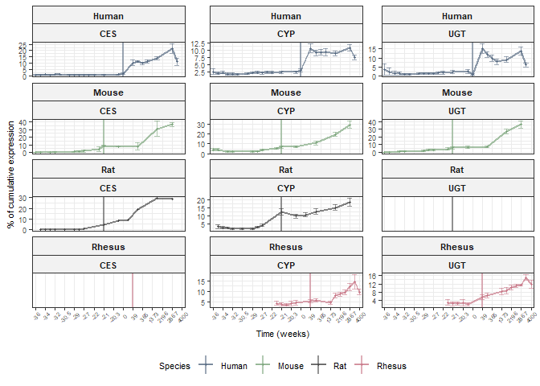<!-- -->

### Plot relevant human genes: adult vs. neonatal

``` r
Relevant_Genes_filled_longer_plot <- Relevant_genes_across_species %>% as.data.frame() %>%  dplyr::filter(GENEID == "CES1" | GENEID == "CES2" | GENEID == "CYP2C19" | GENEID == "UGT2B15") %>% dplyr::filter(Species == "Human")


Relevant_Genes_filled_longer_plot <- Relevant_Genes_filled_longer_plot %>%
  mutate(
    age_class = case_when(
      
      Species == "Human" & timepoint_number %in% c(-20, 0) ~ "neonatal",
      Species == "Human" & timepoint_number %in% c(1861, 2867) ~ "adult",
      TRUE ~ NA_character_
    )
  ) %>% dplyr::filter(age_class == "neonatal"| age_class == "adult")


Relevant_Genes_filled_longer_plot <- Relevant_Genes_filled_longer_plot %>% dplyr::select(GENEID, Class, age_class, CPM) %>% mutate_at(c(1:3), as.factor)

Relevant_Genes_filled_longer_plot$age_class <- factor(
  Relevant_Genes_filled_longer_plot$age_class,
  levels = c("neonatal", "adult")
)


Analysis_CPM <- ggplot(Relevant_Genes_filled_longer_plot, aes(x = age_class, y = CPM, fill = age_class)) +
  geom_boxplot(outlier.shape = NA) +
  geom_point(
    aes(col = age_class),
    position = position_jitterdodge(
      dodge.width = 0.8,
      jitter.width = 0.25
    ),
    size = 1.4,
    alpha = 0.4
  ) + facet_wrap(~GENEID, scales = "free",nrow = 1)+
  labs(
    x     = "",
    y     = expression("Counts per million (CPM)"),
  ) +
  
  scale_fill_manual(values = c("neonatal" = "#F4F5DC", "adult" = "#6F9F7F")) +
  scale_color_manual(values = c("neonatal" = "#B9BC8A", 
                                "adult"   = "#4F7F66"), labels = c("neonatal" = "neonatal/premature",
                                                                   "adult"    = "adult")
  ) +
  theme_bw() + 
  theme(
    axis.text.x     = element_text(angle = 45, hjust = 1, size = 8),
    legend.position = "bottom",
    strip.background = element_rect(fill = "gray95"),
    strip.text.x = element_text(size = 8, face = "bold"),
    axis.text.y = element_text(size = 8),
    axis.title.x = element_text(size = 8),
    axis.title.y = element_text(size = 8),       
    legend.text = element_text(size = 8),
    legend.title = element_text(size = 8)
  ) + 
  theme_bw() +
  theme(
    axis.text.x      = element_text(angle = 45, hjust = 1, size = 8),
    legend.position  = "bottom",
    strip.text.x     = element_text(size = 8, face = "bold")
  )

ggsave(
  filename = here::here("D:/Michi/12_Plasticizer_Parenteral/ES & T_minor_revision_080926/outputs/Analysis_CPM.svg"),
  plot     = Analysis_CPM,
  device   = svglite::svglite,
  width    = 16.5,
  height   = 6.8,
  units = "cm"
)

print(Analysis_CPM)
```

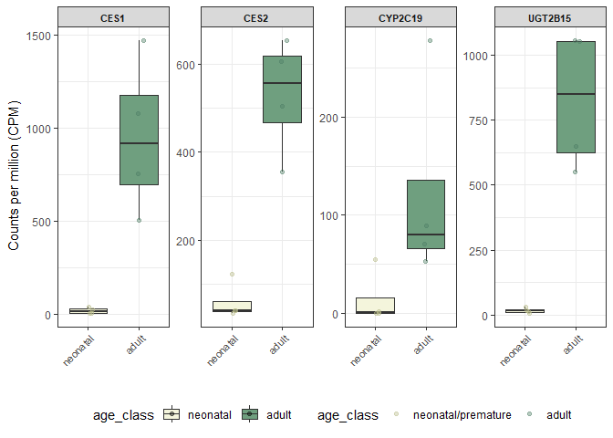<!-- -->

# Pharmacokinetic modeling

### Real-life data from a 28w GA + 1kg BW infant treated at our NICU

``` r
daily_flow_lip <- c(0.21, 0.21, 0.35, 0.48, 0.37, 0, 0, 0,0,0,0,0,0,0)
daily_flow_par <- c(1.06, 1.58, 1.6, 3.24, 2.51, 2.05, 1.14, 0.68, 0, 0, 0, 0, 0, 0)
daily_weight <- c(1.090, 1.030, 1.010, 1.010, 1.010, 1.020, 1.020, 1.040, 1.040, 1.030, 1.070, 1.070, 1.070, 1.100)
days <- 0:(length(daily_flow_lip))
```

## DINP

### Load model data

``` r
# For preterm infant
df <- data.frame(
  ID = 1, 
  TIME = (0:(length(daily_flow_lip)-1)) * 24, # hours instead of days; #correct
  flow_rate_lip = daily_flow_lip, # Flow_rate preterm; #correct
  flow_rate_par = daily_flow_par, # Flow_rate preterm; #correct
  weight = daily_weight, # Real weight of preterm infant; #correct
  MF_CES = 0.34, # protein maturation factor; #correct
  MF_CYP2C19 = 0.302, # protein maturation factor; #correct
  MF_renal = 0.0100, # GFR maturation factor; #correct
  Liver_volume_infant = 21.125, # for liver maturation factor calculation; #correct
  Liver_volume_adult = 1360, # for liver maturation factor calculation; #correct
  Vd_ECF = 0.46, # ECF volume preterm infant; #correct
  Vd_plasma = 0.036, # Plasma volume preterm infant; #correct
  Vd_MINP = 0.63, # MINP Vd preterm infant; #correct
  input_factor_weight = 1 # 1 = global, preterm model; no adaptation; #correct
)

# For preterm infant without enzyme maturation factors (CES = 1, CYP2C19 = 1)
df_no_enzyme <- data.frame(
  ID = 1, # only 1 proband; #correct
  TIME = (0:(length(daily_flow_lip)-1)) * 24, # hours instead of days; #correct
  flow_rate_lip = daily_flow_lip, # Flow_rate preterm; #correct
  flow_rate_par = daily_flow_par, # Flow_rate preterm; #correct
  weight = daily_weight, # Real weight of preterm infant; #correct
  MF_CES = 1, # protein maturation factor -> set to 1 for reduced model; #correct
  MF_CYP2C19 = 1, # protein maturation factor -> set to 1 for reduced model; #correct
  MF_renal = 0.0100, # GFR maturation factor; #correct
  Liver_volume_infant = 21.125, # for liver maturation factor calculation; #correct
  Liver_volume_adult = 1360, # for liver maturation factor calculation; #correct
  Vd_ECF = 0.46, # ECF volume preterm infant; #correct
  Vd_plasma = 0.036, # Plasma volume preterm infant; #correct
  Vd_MINP = 0.63, # MINP Vd preterm infant; #correct
  input_factor_weight = 1 # 1 = global, preterm model; no adaptation; #correct
)


# For adequate comparison to adult values (Maturation factors all set to 1, weight = static 70kg, exposure = scaled, VdECF/Plasma corresponding to adult values)
## Upscaling of exposure to 70kg
df_for_rates <- df
df_for_rates <- df_for_rates %>% mutate(1/weight)
daily_weight_corr <- (df_for_rates$`1/weight`)*70

df_no_enzyme_adult_Vds <- data.frame(
    ID = 1, # only 1 proband; #correct
    TIME = (0:(length(daily_flow_lip)-1)) * 24, # hours instead of days; #correct
    flow_rate_lip = daily_flow_lip, # Flow_rate preterm -> will be scaled in model; #correct
    flow_rate_par = daily_flow_par, # Flow_rate preterm -> will be scaled in model; #correct
    weight = 70, # static for 70kg model adult; #correct
    MF_CES = 1, # no maturation; #correct
    MF_CYP2C19 = 1, # no maturation; #correct
    MF_renal = 1, # no maturation; #correct
    Liver_volume_infant = 1, # no maturation; #correct
    Liver_volume_adult = 1, # no maturation; #correct
    Vd_ECF = 0.2, # Adult ECF Vd; #correct
    Vd_plasma = 0.05, # Adult Plasma Vd; #correct
    Vd_MINP = 0.5, # Adult MINP Vd; #correct
    input_factor_weight = daily_weight_corr # correction of exposure to 70kg weight; #correct
  )

rm(daily_flow_lip, daily_flow_par, daily_weight, daily_weight_corr, days, df_for_rates)
```

### Expand model data to hourly grid

``` r
# Preterm: full model
df <- df %>%
  arrange(TIME) %>%
  distinct(TIME, .keep_all = TRUE) %>%
  complete(TIME = seq(min(TIME), max(TIME), by = 1)) %>%
  arrange(TIME) %>%
  fill(-TIME, .direction = "down")

# Preterm: reduced model
df_no_enzyme <- df_no_enzyme %>%
  arrange(TIME) %>%
  distinct(TIME, .keep_all = TRUE) %>%
  complete(TIME = seq(min(TIME), max(TIME), by = 1)) %>%
  arrange(TIME) %>%
  fill(-TIME, .direction = "down")

# Adult: Reference model
df_no_enzyme_adult_Vds <- df_no_enzyme_adult_Vds %>%
  arrange(TIME) %>%
  distinct(TIME, .keep_all = TRUE) %>%
  complete(TIME = seq(min(TIME), max(TIME), by = 1)) %>%
  arrange(TIME) %>%
  fill(-TIME, .direction = "down")
```

### Create DINP model in mrgsolve

``` r
DINP_model <- mcode("plasticizer_biphasic_timefun", "

$PARAM
  Vd_DINP = 0.8  // L per kg; correct; calculated as Vd= ((10*0.230)/12.5)/0.230 (https://www.sciencedirect.com/science/article/pii/S0378517313003347?via%3Dihub);
  Vd_MINP = 0.63 // L per kg; correct, preterm
  Vd_ECF = 0.46 // L per kg; correct, preterm
  Vd_plasma = 0.036 // L per kg; correct, preterm
  CL_DINP = 1.836  // L per h per kg; correct; calculated from i.v. data as CL = 30.6ml/min/kg * 60/1000 
  CL_MINP = 2.23   // L per h; hepatic Clearance human (https://www.tandfonline.com/doi/full/10.1080/00498254.2018.1471753?src=recsys#d1e381), calculated;
  kg_AD =  74.8 // in kg from (https://www.sciencedirect.com/science/article/pii/S0278691511002092?via%3Dihub);
  t1_2_oh_MINP = 6    // h; correct  
  t1_2_oxo_MINP = 6   // h; correct
  t1_2_cx_MINP = 8    // h; correct
  MF_CES = 0.34       // arbitrary units; correct 
  MF_CYP2C19 = 0.302   // arbitrary units; correct
  MF_renal = 0.0100 // arbitrary units; correct; calculated as: (16.2*(0.1087/1.73))/(101*(1.73/1.73));
  Liver_volume_infant = 21.125 // cm^3; correct
  Liver_volume_adult = 1360 // cm^3; correct
  flow_rate_lip = 0.21 // ml/h, Start, replaced by values in df; correct
  flow_rate_par = 1.06 // ml/h, Start, replaced by values in df; correct
  weight = 1.09 // kg, Start, replace by values in df; correct
  MW = 418.609 // g/mol DINP; correct
  input_factor_weight = 1 // arbitrary units, just relevant for adults, for preterms always 1; correct

  // perfusor release function parameters (as calculated from own data) correct
  a0 = 285.4
  a1 = 79.31
  a2 = -1.63

$CMT DINP MINP oh_MINP oxo_MINP cx_MINP unknown_metabolites // amount in body (nmol)

$MAIN
  // --- Liver scaling #correct, ratio of cm^3---
  double Liver_V_ratio = Liver_volume_infant/Liver_volume_adult; 
  
  // --- growth, # correct, in kg ---
  double BW = weight;
  
  // --- time modeling per day perfusor rate #correct  ---
  double day = floor(TIME/24);              
  double flow_rate = flow_rate_lip;
  
  // --- time-dependent infusion #correct ---
  double tp = fmod(TIME, 24); 
  double Rin = ((a0 + a1*tp + a2*(tp*tp)) * (flow_rate*input_factor_weight))/MW;
  
  // --- Clearance, DINP #correct ---
  double CL_DINP_human_neo = (((0.152*CL_DINP)*70)*Liver_V_ratio)*MF_CES;
  
  // --- Clearance, MINP #correct ---
  double CL_MINP_human_neo_basic = (CL_MINP*Liver_V_ratio)*MF_CYP2C19;
  
  // --- Clearance, MINP, known/unknown #correct ---
  double CL_MINP_to_clear_MINP = CL_MINP_human_neo_basic*0.465; 
  double CL_MINP_to_unclear_MINP = CL_MINP_human_neo_basic*0.535;
  
  // --- Clearance Phase I # correct ---
  double CL_MINP_to_OH_MINP = CL_MINP_to_clear_MINP*(0.2018*(100/41.46));  
  double CL_MINP_to_oxo_MINP = CL_MINP_to_clear_MINP*(0.1060*(100/41.46)); 
  double CL_MINP_to_cx_MINP = CL_MINP_to_clear_MINP*(0.1068*(100/41.46)); 
  
  // --- Adapted clearance for renally eliminated compounds in preterm infants ---
  double CL_OH_MINP = (((0.693*(Vd_ECF*kg_AD))/t1_2_oh_MINP)/(kg_AD/70))*MF_renal; 
  double CL_oxo_MINP = (((0.693*(Vd_ECF*kg_AD))/t1_2_oxo_MINP)/(kg_AD/70))*MF_renal; 
  double CL_cx_MINP = (((0.693*(Vd_ECF*kg_AD))/t1_2_cx_MINP)/(kg_AD/70))*MF_renal; 
  
  // --- neonatal distribution volume  ---
  double V_child_DINP  = Vd_DINP*BW; 
  double V_child_MINP = Vd_MINP*BW; 
  double V_child_ECF  = Vd_ECF*BW; 
  double V_child_Plasma  = Vd_plasma*BW; 

$ODE
  dxdt_DINP = Rin - (CL_DINP_human_neo/V_child_DINP) * DINP; 
  dxdt_MINP = DINP * (CL_DINP_human_neo/V_child_DINP) - MINP * (CL_MINP_human_neo_basic/V_child_MINP); 
  dxdt_oh_MINP = MINP * (CL_MINP_to_OH_MINP/V_child_MINP) - oh_MINP*(CL_OH_MINP/V_child_ECF); 
  dxdt_oxo_MINP = MINP * (CL_MINP_to_oxo_MINP/V_child_MINP) - oxo_MINP*(CL_oxo_MINP/V_child_ECF); 
  dxdt_cx_MINP = MINP * (CL_MINP_to_cx_MINP/V_child_MINP) - cx_MINP*(CL_cx_MINP/V_child_ECF); 
  
$TABLE
  double C_DINP = DINP/V_child_DINP; 
  double C_MINP = MINP/V_child_MINP; 
  double DINP_kg = (DINP*MW)/BW; 
  double MINP_kg = (MINP*292.375)/BW; 
  
  double C_oh_MINP_total = oh_MINP/V_child_ECF; 
  double C_oh_MINP_free = (oh_MINP*(1-0.45))/V_child_ECF; 
  double C_oh_MINP_GLUC = (oh_MINP*0.45)/V_child_Plasma; 
  double oh_MINP_free_kg = ((oh_MINP*(1-0.45))*308.374)/BW; 
  double oh_MINP_GLUC_kg = ((oh_MINP*(0.45))*308.374)/BW; 
  
  double C_oxo_MINP_total = oxo_MINP/V_child_ECF; 
  double C_oxo_MINP_free = (oxo_MINP*(1-0.95))/V_child_ECF; 
  double C_oxo_MINP_GLUC = (oxo_MINP*0.95)/V_child_Plasma; 
  double oxo_MINP_free_kg = ((oxo_MINP*(1-0.95))*306.358)/BW; 
  double oxo_MINP_GLUC_kg = ((oxo_MINP*(0.95))*306.358)/BW; 
  
  double C_cx_MINP_total = cx_MINP/V_child_ECF; 
  double C_cx_MINP_free = (cx_MINP*(1-0.35))/V_child_ECF; 
  double C_cx_MINP_GLUC = (cx_MINP*0.35)/V_child_Plasma; 
  double cx_MINP_free_kg = ((cx_MINP*(1-0.35))*322.357)/BW; 
  double cx_MINP_GLUC_kg = ((cx_MINP*(0.35))*322.357)/BW; 
  


$CAPTURE C_DINP C_MINP 
C_oh_MINP_total C_oh_MINP_free 
C_oh_MINP_GLUC C_oxo_MINP_total 
C_oxo_MINP_free C_oxo_MINP_GLUC 
C_cx_MINP_total C_cx_MINP_free 
C_cx_MINP_GLUC DINP_kg MINP_kg 
oh_MINP_free_kg oh_MINP_GLUC_kg 
oxo_MINP_free_kg oxo_MINP_GLUC_kg 
cx_MINP_free_kg cx_MINP_GLUC_kg Rin
")
```

    ## Building plasticizer_biphasic_timefun ... done.

### Create output dataframes for wrangling and plotting

``` r
out <- DINP_model %>%
  data_set(df) %>%
  mrgsim(start = 0, end = 24, delta = 1) %>%
  mrgsolve::as.data.frame()

out_no_enzyme <- DINP_model %>%
  data_set(df_no_enzyme) %>%
  mrgsim(start = 0, end = 24, delta = 1) %>%
  mrgsolve::as.data.frame()

out_no_enzyme_ad_vds <- DINP_model %>%
  data_set(df_no_enzyme_adult_Vds) %>%
  mrgsim(start = 0, end = 24, delta = 1) %>%
  mrgsolve::as.data.frame()

rm(DINP_model)
```

### Wrangle DINP models into one pivot-longer-type dataframe

``` r
out <- out %>% dplyr::select(c(1:2, 9:28))
out_plot <- out %>% pivot_longer(cols = c(3:22), names_to = "Output", values_to = "nmol/L")
out_plot <- out_plot %>% dplyr::mutate_at(c(3), as.factor)
out_plot$type <- c("Preterm: full model")

out_no_enzyme <- out_no_enzyme %>% dplyr::select(c(1:2, 9:28))
out_no_enzyme_plot <- out_no_enzyme %>% pivot_longer(cols = c(3:22), names_to = "Output", values_to = "nmol/L")
out_no_enzyme_plot <- out_no_enzyme_plot %>% dplyr::mutate_at(c(3), as.factor)
out_no_enzyme_plot$type <- c("Preterm: reduced model")

out_no_enzyme_ad_vds <- out_no_enzyme_ad_vds %>% dplyr::select(c(1:2, 9:28))
out_no_enzyme_ad_vds_plot <- out_no_enzyme_ad_vds %>% pivot_longer(cols = c(3:22), names_to = "Output", values_to = "nmol/L")
out_no_enzyme_ad_vds_plot <- out_no_enzyme_ad_vds_plot %>% dplyr::mutate_at(c(3), as.factor)
out_no_enzyme_ad_vds_plot$type <- c("Adult: reference model")

models <- rbind(out_plot, out_no_enzyme_plot, out_no_enzyme_ad_vds_plot)
models <- models %>% mutate_at(c(3,5), as.factor)

# Get one global df for weight-exposure
DINP_per_kg <- c("DINP_kg", "MINP_kg", "oh_MINP_free_kg", "oh_MINP_GLUC_kg", "oxo_MINP_free_kg", "oxo_MINP_GLUC_kg", "cx_MINP_free_kg", "cx_MINP_GLUC_kg", "Rin") 
models_DINP_kg <- subset(models, (models$Output %in% DINP_per_kg))

# Get one global df for concentrations within the well-stirred compartment
models_DINP_conc <- subset(models, !(models$Output %in% DINP_per_kg))

rm(df, df_no_enzyme, df_no_enzyme_adult_Vds,models, DINP_per_kg, out, out_no_enzyme, out_no_enzyme_plot, out_no_enzyme_ad_vds, out_no_enzyme_ad_vds_plot, out_plot)
```

### Plot the model

``` r
output_labs_DINP <- c(
  C_DINP            = "DINP",
  C_MINP            = "MINP",
  
  C_oh_MINP_total   = "7-OH-MINP (total)",
  C_oh_MINP_free    = "7-OH-MINP",
  C_oh_MINP_GLUC    = "7-OH-MINP-gluc.",
  
  C_oxo_MINP_total  = "7-oxo-MINP (total)",
  C_oxo_MINP_free   = "7-oxo-MINP",
  C_oxo_MINP_GLUC   = "7-oxo-MINP-gluc.",
  
  C_cx_MINP_total   = "7-cx-MINP (total)",
  C_cx_MINP_free    = "7-cx-MINP",
  C_cx_MINP_GLUC    = "7-cx-MINP-gluc.")

output_labs_DINP_kg <- c(
  DINP_kg = "DINP",
  MINP_kg = "MINP",
  oh_MINP_free_kg = "7-OH-MINP",
  oh_MINP_GLUC_kg =  "7-OH-MINP-gluc.",
  
  oxo_MINP_free_kg = "7-oxo-MINP",
  oxo_MINP_GLUC_kg = "7-oxo-MINP-gluc.",
  
  cx_MINP_free_kg = "7-cx-MINP",
  cx_MINP_GLUC_kg ="7-cx-MINP-gluc.",
  Rin = "Infusion (nmol/h)")


output_order <- c(
  "C_DINP", "C_MINP",
  "C_oh_MINP_total", "C_oxo_MINP_total", "C_cx_MINP_total",
  "C_oh_MINP_free",  "C_oxo_MINP_free",  "C_cx_MINP_free",
  "C_oh_MINP_GLUC",  "C_oxo_MINP_GLUC",  "C_cx_MINP_GLUC"
)

output_order_kg <- c(
  "DINP_kg", "MINP_kg",
  "oh_MINP_free_kg", "oh_MINP_GLUC_kg", "oxo_MINP_free_kg",
  "oxo_MINP_GLUC_kg",  "cx_MINP_free_kg",  "cx_MINP_GLUC_kg",
  "Rin")

models_DINP_conc <- models_DINP_conc %>%
  dplyr::mutate(Output = factor(Output, levels = output_order))

models_DINP_kg <- models_DINP_kg %>%
  dplyr::mutate(Output = factor(Output, levels = output_order_kg))

type_cols <- c("Preterm: reduced model" = "#5B6E85", "Adult: reference model" = "#7FA77F", "Preterm: full model" = "#C97A8A")

Concentration_DINP_fixed_scales <- ggplot(models_DINP_conc,
       aes(x = TIME / 24, y = `nmol/L`,
           colour = type, fill = type)) +
  geom_line(linewidth = 0.7, alpha = 0.9) +
  
  scale_colour_manual(values = type_cols) +
  scale_fill_manual(values = type_cols) +
  
  scale_x_continuous(
    breaks = seq(0, ceiling(max(models_DINP_conc$TIME / 24)), by = 1)
  ) +
  labs(
    x = "Time (days)",
    y = "DINP + derivatives [nM]",
    title = "Exposure to DINP - fixed scales"
  ) +
  theme_bw() +
   facet_wrap(
    . ~ Output,
    labeller = labeller(Output = output_labs_DINP)
  ) +
  theme(
    panel.grid.major = element_line(linewidth = 0.3),
    panel.grid.minor = element_blank(),
    
    axis.text.x  = element_text(size = 8),
    axis.text.y  = element_text(size = 8),
    axis.title.x = element_text(size = 8),
    axis.title.y = element_text(size = 8),
    plot.title   = element_text(size = 12, face = "bold", hjust = 0.5),
    axis.line    = element_line(linewidth = 0.4)
  )


print(Concentration_DINP_fixed_scales)
```

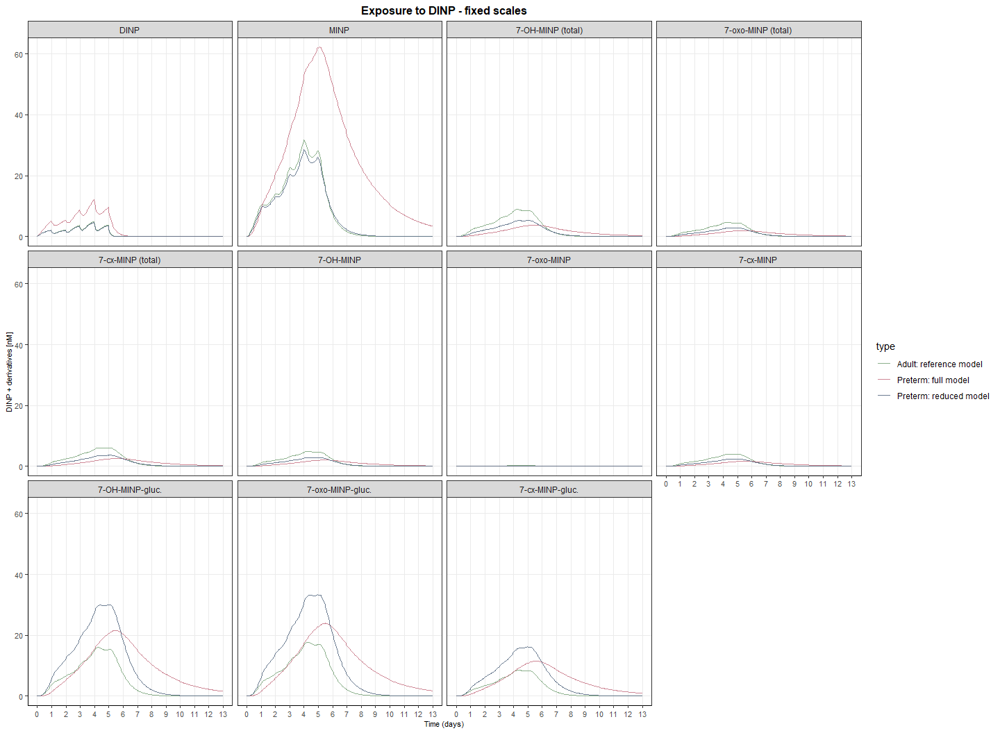<!-- -->

``` r
graph2svg(Concentration_DINP_fixed_scales, file = "D:/Michi/12_Plasticizer_Parenteral/Figures/DINP_model_fixed_scales.svg", width = 6.8, height = 4.7)
```

    ## Exported graph as D:/Michi/12_Plasticizer_Parenteral/Figures/DINP_model_fixed_scales.svg

``` r
Concentration_DINP_free_scales <- ggplot(models_DINP_conc,
       aes(x = TIME / 24, y = `nmol/L`,
           colour = type, fill = type)) +
  geom_line(linewidth = 0.9, alpha = 0.9) +
  
  scale_colour_manual(values = type_cols) +
  scale_fill_manual(values = type_cols) +
  
  scale_x_continuous(
    breaks = seq(0, ceiling(max(models_DINP_conc$TIME / 24)), by = 1)
  ) +
  labs(
    x = "Time (days)",
    y = "DINP + derivatives [nmol/L]",
    title = "Exposure to DINP - free scales"
  ) +
  theme_bw() +
   facet_wrap(
    . ~ Output, scales = "free",
    labeller = labeller(Output = output_labs_DINP)
  ) +
  theme(
    panel.grid.major = element_line(linewidth = 0.3),
    panel.grid.minor = element_blank(),
    
    axis.text.x  = element_text(size = 8),
    axis.text.y  = element_text(size = 8),
    axis.title.x = element_text(size = 8),
    axis.title.y = element_text(size = 8),
    plot.title   = element_text(size = 12, face = "bold", hjust = 0.5),
    axis.line    = element_line(linewidth = 0.4)
  )

print(Concentration_DINP_free_scales)
```

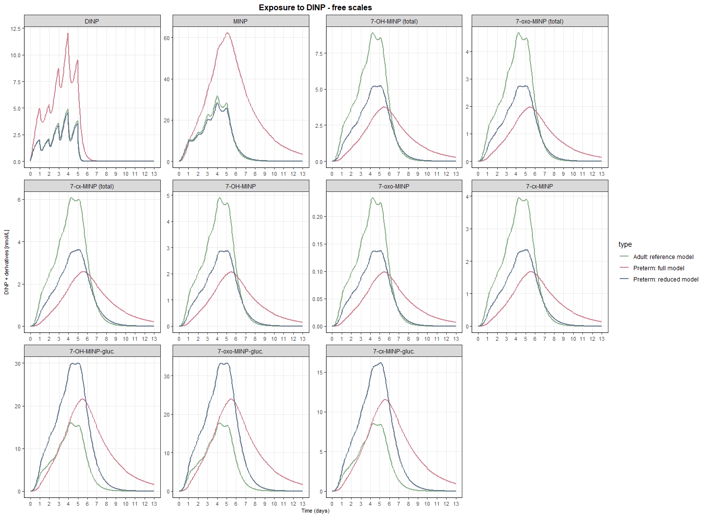<!-- -->

``` r
graph2svg(Concentration_DINP_free_scales, file = "D:/Michi/12_Plasticizer_Parenteral/Co_author_comments_03.26/Updated_Plots/DINP_model_free_scales_180326.svg", width = 7.5, height = 4.7)
```

    ## Exported graph as D:/Michi/12_Plasticizer_Parenteral/Co_author_comments_03.26/Updated_Plots/DINP_model_free_scales_180326.svg

``` r
ng_pro_kg_DINP_free_scales <- ggplot(models_DINP_kg,
       aes(x = TIME / 24, y = `nmol/L`,
           colour = type, fill = type)) +
  geom_line(linewidth = 0.9, alpha = 0.9) +
  
  scale_colour_manual(values = type_cols) +
  scale_fill_manual(values = type_cols) +
  
  scale_x_continuous(
    breaks = seq(0, ceiling(max(models_DINP_kg$TIME / 24)), by = 1)
  ) +
  labs(
    x = "Time (days)",
    y = "DINP + derivatives [ng/kg]",
    title = "Exposure to DINP - free scales"
  ) +
  theme_bw() +
   facet_wrap(
    . ~ Output, scales = "free",
    labeller = labeller(Output = output_labs_DINP_kg)
  ) +
  theme(
    panel.grid.major = element_line(linewidth = 0.3),
    panel.grid.minor = element_blank(),
    
    axis.text.x  = element_text(size = 8),
    axis.text.y  = element_text(size = 8),
    axis.title.x = element_text(size = 8),
    axis.title.y = element_text(size = 8),
    plot.title   = element_text(size = 12, face = "bold", hjust = 0.5),
    axis.line    = element_line(linewidth = 0.4)
  )
print(ng_pro_kg_DINP_free_scales)
```

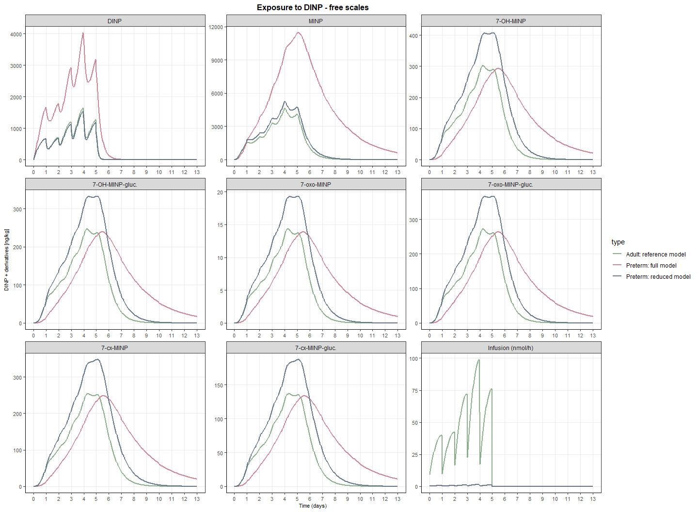<!-- -->

``` r
graph2svg(ng_pro_kg_DINP_free_scales, file = "D:/Michi/12_Plasticizer_Parenteral/Co_author_comments_03.26/Updated_Plots/ng_pro_kg_DINP_free_scales_18.03.26.svg", width = 6.45, height = 4.65)
```

    ## Exported graph as D:/Michi/12_Plasticizer_Parenteral/Co_author_comments_03.26/Updated_Plots/ng_pro_kg_DINP_free_scales_18.03.26.svg

``` r
models_DINP_RIN <- models_DINP_kg %>% dplyr::filter(Output == "Rin") %>% dplyr::filter(type != "Preterm: full model")

RIN_DINP <- ggplot(models_DINP_RIN,
       aes(x = TIME / 24, y = `nmol/L`,
           colour = Output, fill = Output)) +
  geom_line(linewidth = 0.9, alpha = 0.9) +
  
  scale_colour_manual(values = c("Rin" = "#D8C6A0"), labels = c("Rin" = "Lipid mixture")) +
  scale_fill_manual(values = c("Rin" = "#D8C6A0"), labels = c("Rin" = "Lipid mixture")) +
  scale_x_continuous(
    breaks = seq(0, ceiling(max(models_DINP_kg$TIME / 24)), by = 1)
  ) +
  labs(
    x = "Time (days)",
    y = "nmol/h",
    title = "Rin DINP"
  ) +
  theme_bw() +
   facet_wrap(
    . ~ type, scales = "free",
    labeller = labeller(type = c(
      "Adult: reference model" = "Adult DINP Exposure",
      "Preterm: reduced model" = "Preterm DINP Exposure"
    ))
  ) +
 theme(
    panel.grid.major = element_line(linewidth = 0.3),
    panel.grid.minor = element_blank(),
    
    axis.text.x  = element_text(size = 8),
    axis.text.y  = element_text(size = 8),
    axis.title.x = element_text(size = 8),
    axis.title.y = element_text(size = 8),
    plot.title   = element_text(size = 12, face = "bold", hjust = 0.5),
    axis.line    = element_line(linewidth = 0.4)
  )


print(RIN_DINP)
```

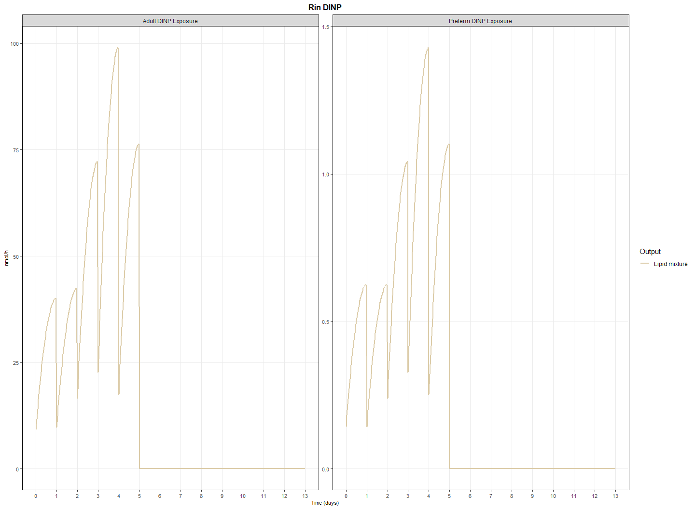<!-- -->

``` r
graph2svg(RIN_DINP, file = "D:/Michi/12_Plasticizer_Parenteral/Co_author_comments_03.26/Updated_Plots/RIN_DINP_18.03.26.svg", width = 4.8, height = 2.2)
```

    ## Exported graph as D:/Michi/12_Plasticizer_Parenteral/Co_author_comments_03.26/Updated_Plots/RIN_DINP_18.03.26.svg

``` r
rm(output_labs, output_order, type_cols, compound_levels)
```

## Bisphenol-A model

### Real-life data from a 28w GA + 1kg BW infant treated at our NICU

``` r
daily_flow_lip <- c(0.21, 0.21, 0.35, 0.48, 0.37, 0, 0, 0,0,0,0,0,0,0)
daily_flow_par <- c(1.06, 1.58, 1.6, 3.24, 2.51, 2.05, 1.14, 0.68, 0, 0, 0, 0, 0, 0)
daily_weight <- c(1.090, 1.030, 1.010, 1.010, 1.010, 1.020, 1.020, 1.040, 1.040, 1.030, 1.070, 1.070, 1.070, 1.100)
days <- 0:(length(daily_flow_lip))
```

### Load model data

``` r
# For preterm infant
df <- data.frame(
  ID = 1, # only 1 proband; #correct
  TIME = (0:(length(daily_flow_lip)-1))*24, # hours instead of days; #correct
  flow_rate_lip = daily_flow_lip, # Flow_rate preterm; #correct
  flow_rate_par = daily_flow_par, # Flow_rate preterm; #correct
  weight = daily_weight, # Real weight of preterm infant; #correct
  MF_UGT = 0.15, # protein maturation factor; correct
  MF_SULT = 0.42, # protein maturation factor; correct
  MF_renal = 0.0100, # GFR maturation factor; correct
  Liver_volume_infant = 21.125, # for liver maturation factor calculation; correct
  Liver_volume_adult = 1360, # for liver maturation factor calculation; correct
  input_factor_weight = 1 # 1 = global, preterm model; no adaptation; correct
)

# For preterm infant without enzyme maturation factors (UGT = 1, SULT = 1)
df_no_enzyme <- data.frame(
  ID = 1, # only 1 proband; #correct
  TIME = (0:(length(daily_flow_lip)-1))*24, # hours instead of days; #correct
  flow_rate_lip = daily_flow_lip, # Flow_rate preterm; #correct
  flow_rate_par = daily_flow_par, # Flow_rate preterm; #correct
  weight = daily_weight, # Real weight of preterm infant; #correct
  MF_UGT = 1, # protein maturation factor set to 1; #correct
  MF_SULT = 1, # protein maturation factor set to 1; #correct
  MF_renal = 0.0100, # GFR maturation factor; #correct
  Liver_volume_infant = 21.125, # for liver maturation factor calculation; #correct
  Liver_volume_adult = 1360, # for liver maturation factor calculation; #correct
  input_factor_weight = 1 # 1 = global, preterm model; no adaptation; #correct
)


# For comparison to adult values (Maturation factors all set to 1, weight = static 70kg, exposure = scaled, VdECF/Plasma to adult values)
## Upscaling of exposure to 70kg
df_for_rates <- df
df_for_rates <- df_for_rates %>% mutate(1/weight)
daily_weight_corr <- (df_for_rates$`1/weight`)*70

df_no_enzyme_adult_Vds <- data.frame(
  ID = 1, # only 1 proband; #correct
  TIME = (0:(length(daily_flow_lip)-1))*24, # hours instead of days; #correct
  flow_rate_lip = daily_flow_lip, # correct
  flow_rate_par = daily_flow_par, #correct
  weight = 70, #correct
  MF_UGT = 1, # protein maturation factor set to 1; #correct
  MF_SULT = 1, # protein maturation factor set to 1; #correct
  MF_renal = 1, # GFR maturation factor set to 1; #correct
  Liver_volume_infant = 1, # for liver maturation factor set to 1; #correct
  Liver_volume_adult = 1, # for liver maturation factor set to 1; #correct
  input_factor_weight = daily_weight_corr#correct
)

rm(daily_flow_lip, daily_flow_par, daily_weight, daily_weight_corr, days, df_for_rates)
```

### Expand model data to hourly grid

``` r
# Preterm: full model
df <- df %>%
  arrange(TIME) %>%
  distinct(TIME, .keep_all = TRUE) %>%
  complete(TIME = seq(min(TIME), max(TIME), by = 1)) %>%
  arrange(TIME) %>%
  fill(-TIME, .direction = "down")

# Preterm: reduced model
df_no_enzyme <- df_no_enzyme %>%
  arrange(TIME) %>%
  distinct(TIME, .keep_all = TRUE) %>%
  complete(TIME = seq(min(TIME), max(TIME), by = 1)) %>%
  arrange(TIME) %>%
  fill(-TIME, .direction = "down")

# Adult: reference model
df_no_enzyme_adult_Vds <- df_no_enzyme_adult_Vds %>%
  arrange(TIME) %>%
  distinct(TIME, .keep_all = TRUE) %>%
  complete(TIME = seq(min(TIME), max(TIME), by = 1)) %>%
  arrange(TIME) %>%
  fill(-TIME, .direction = "down")
```

### Create BPA model in mrgsolve

``` r
BPA_model <- mcode("plasticizer_biphasic_timefun", "

$PARAM
  Vd_BPA_free = 1.79 // L per kg; correct (Table 49)
  Vd_BPA_gluc = 0.13 // L per kg; correct
  Vd_BPA_sulf = 0.12 // L per kg; correct
  t1_2_BPA_free = 5.6 // h; correct
  t1_2_BPA_gluc = 5.5 // h; correct
  t1_2_BPA_sulf = 4.4 // h; correct
  kg_AD = 82  // kg; correct
  MF_UGT = 0.15 // arbitrary units, protein ratio; correct
  MF_SULT = 0.42  // arbitrary units, protein ratio; correct
  MF_renal = 0.0100 // arbitrary units, calculated as GFR_absoute_preterm = (16.2*(0.1087/1.73))/(101.5*(1.73/1.73)); correct
  Liver_volume_infant = 21.125 // cm^3; correct
  Liver_volume_adult = 1360 // cm^3; correct
  flow_rate_lip = 0.21 // ml/h, Start, replaced by values in df; correct
  flow_rate_par = 1.06 // ml/h, Start, replaced by values in df; correct
  weight = 1.09 // kg, Start, replace by values in df; correct
  MW = 228.29 //g/mol BPA; correct
  input_factor_weight = 1 // arbitrary units; correct

  // perfusor release function parameters (as calculated from own data)
  a0 = -2.2 
  a1 = 135.5 
  a2 = 0.144 

$CMT BPA_free BPA_gluc BPA_sulf                  // amount in body (nmoles)

$MAIN
  // --- Liver scaling  ---
  double Liver_V_ratio = Liver_volume_infant/Liver_volume_adult; 
  
  // --- growth,  ---
  double BW = weight; 
  
  // --- Clearance, BPA free, Liver scaled  ---
  double CL_BPA_free_child_basic = (((0.693*(Vd_BPA_free*kg_AD))/t1_2_BPA_free)/(kg_AD/70))*Liver_V_ratio;  
  
  // --- time modeling per day perfusor rate   ---
  double day = floor(TIME/24);        // 
  double flow_rate_1 = flow_rate_par; // ml/h
  double flow_rate_2 = flow_rate_lip; // ml/h
  
  // --- time-dependent infusion  ---
  double tp = fmod(TIME, 24); // hours since start of day
  double Rin1 = ((a0 + a1/(tp + a2)) * (flow_rate_1*input_factor_weight))/MW; // nmol/h, based on aqueous data; 
  double Rin2 = (245.04 * (flow_rate_2*input_factor_weight))/MW; // nmol/h, based on lipid data; 
  double Rin = Rin1 + Rin2; 
  
  // Rin fractionation 
  double Rin_free = Rin * 0.28; 
  double Rin_gluc = (Rin * 0.72)*0.842; 
  double Rin_sulf = (Rin * 0.72)*0.158; 
  
  // --- Metabolically adapted clearance for hepatic conversion of free BPA in preterms  ---
  double CL_BPA_free_to_Gluc = (CL_BPA_free_child_basic*0.842)*MF_UGT; 
  double CL_BPA_free_to_Sulf = (CL_BPA_free_child_basic*0.158)*MF_SULT; 
  double CL_BPA_free_total = CL_BPA_free_to_Gluc + CL_BPA_free_to_Sulf; 
  
  // --- Adapted clearance for renally eliminated compounds in preterm infants ---
  double CL_BPA_gluc_child = (((0.693*(Vd_BPA_gluc*kg_AD))/t1_2_BPA_gluc)/(kg_AD/70))*MF_renal; 
  double CL_BPA_sulf_child = (((0.693*(Vd_BPA_sulf*kg_AD))/t1_2_BPA_sulf)/(kg_AD/70))*MF_renal; 
  
  // --- neonatal distribution volume,  ---
  double V_child_BPA_free  = Vd_BPA_free*BW; 
  double V_child_BPA_gluc  = Vd_BPA_gluc*BW; 
  double V_child_BPA_sulf  = Vd_BPA_sulf*BW; 
  

$ODE
  dxdt_BPA_free = Rin_free - (CL_BPA_free_total/V_child_BPA_free) * BPA_free; 
  dxdt_BPA_gluc = Rin_gluc + BPA_free*(CL_BPA_free_to_Gluc/V_child_BPA_free) - (CL_BPA_gluc_child/V_child_BPA_gluc) * BPA_gluc; 
  dxdt_BPA_sulf = Rin_sulf + BPA_free*(CL_BPA_free_to_Sulf/V_child_BPA_free) - (CL_BPA_sulf_child/V_child_BPA_sulf) * BPA_sulf; 

$TABLE
  double C_BPA_free_total_nmol = (BPA_free/V_child_BPA_free); 
  double C_BPA_free_non_protein_nmol = (BPA_free/V_child_BPA_free)*0.050; 
  double C_BPA_free_protein_nmol = (BPA_free/V_child_BPA_free)*0.95; 
  
  double BPA_free_total_kg = (BPA_free*MW)/BW; 
  double BPA_free_non_protein_kg = ((BPA_free*0.050)*MW)/BW; 
  double BPA_free_protein_kg = ((BPA_free*0.950)*MW)/BW; 
  
  double C_BPA_Gluc_nmol = (BPA_gluc/V_child_BPA_gluc); 
  double BPA_Gluc_kg = (BPA_gluc*404.4)/BW; 
  
  double C_BPA_Sulf_nmol = (BPA_sulf/V_child_BPA_sulf); 
  double BPA_Sulf_kg = (BPA_sulf*308.4)/BW; 

$CAPTURE C_BPA_free_total_nmol C_BPA_free_non_protein_nmol C_BPA_free_protein_nmol C_BPA_Gluc_nmol C_BPA_Sulf_nmol BPA_free_total_kg BPA_free_non_protein_kg BPA_Gluc_kg BPA_Sulf_kg Rin Rin1 Rin2
")
```

    ## Building plasticizer_biphasic_timefun ... done.

### Create output dataframes for wrangling and plotting

``` r
out <- BPA_model %>%
  data_set(df) %>%
  mrgsim(start = 0, end = 24, delta = 1) %>%
  mrgsolve::as.data.frame()

out_no_enzyme <- BPA_model %>%
  data_set(df_no_enzyme) %>%
  mrgsim(start = 0, end = 24, delta = 1) %>%
  mrgsolve::as.data.frame()

out_no_enzyme_ad_vds <- BPA_model %>%
  data_set(df_no_enzyme_adult_Vds) %>%
  mrgsim(start = 0, end = 24, delta = 1) %>%
  mrgsolve::as.data.frame()

rm(BPA_model)
```

### Wrangle BPA models into one pivot-longer-type dataframe

``` r
out <- out %>% dplyr::select(c(1:2, 6:17))
out_plot <- out %>% pivot_longer(cols = c(3:14), names_to = "Output", values_to = "nmol/L")
out_plot <- out_plot %>% dplyr::mutate_at(c(3), as.factor)
out_plot$type <- c("Preterm: full model")

out_no_enzyme <- out_no_enzyme %>% dplyr::select(c(1:2,6:17))
out_no_enzyme_plot <- out_no_enzyme %>% pivot_longer(cols = c(3:14), names_to = "Output", values_to = "nmol/L")
out_no_enzyme_plot <- out_no_enzyme_plot %>% dplyr::mutate_at(c(3), as.factor)
out_no_enzyme_plot$type <- c("Preterm: reduced model")

out_no_enzyme_ad_vds <- out_no_enzyme_ad_vds %>% dplyr::select(c(1:2, 6:17))
out_no_enzyme_ad_vds_plot <- out_no_enzyme_ad_vds %>% pivot_longer(cols = c(3:14), names_to = "Output", values_to = "nmol/L")
out_no_enzyme_ad_vds_plot <- out_no_enzyme_ad_vds_plot %>% dplyr::mutate_at(c(3), as.factor)
out_no_enzyme_ad_vds_plot$type <- c("Adult: reference model")

models <- rbind(out_plot, out_no_enzyme_plot, out_no_enzyme_ad_vds_plot)
models <- models %>% mutate_at(c(3,5), as.factor)

# Get one global df for weight-exposure
BPA_per_kg <- c("BPA_free_non_protein_kg", "BPA_free_total_kg", "BPA_Gluc_kg", "BPA_Sulf_kg", "Rin", "Rin1", "Rin2") 
models_BPA_kg <- subset(models, (models$Output %in% BPA_per_kg))

# Get one global df for concentrations within the well-stirred compartment
models_BPA_conc <- subset(models, !(models$Output %in% BPA_per_kg))

rm(df, df_no_enzyme, df_no_enzyme_adult_Vds,models, BPA_per_kg, out, out_no_enzyme, out_no_enzyme_plot, out_no_enzyme_ad_vds, out_no_enzyme_ad_vds_plot, out_plot)
```

### Plot the model

``` r
output_labs_BPA <- c(
  C_BPA_free_total_nmol = "BPA (total)",
  C_BPA_free_non_protein_nmol = "BPA (free)",
  C_BPA_free_protein_nmol = "BPA (protein bound)",
  C_BPA_Gluc_nmol   = "BPA-gluc.",
  C_BPA_Sulf_nmol   = "BPA-sulf.")

output_labs_BPA_kg <- c(
  BPA_free_total_kg = "BPA (total)",
  BPA_free_non_protein_kg = "BPA (free)",
  BPA_Gluc_kg = "BPA-gluc.",
  BPA_Sulf_kg   = "BPA-sulf.",
  Rin   = "Infusion (nmol/h)")


output_order <- c(
  "C_BPA_free_non_protein_nmol", "C_BPA_free_total_nmol",
  "C_BPA_free_protein_nmol", "C_BPA_Gluc_nmol", "C_BPA_Sulf_nmol")

output_order_kg_BPA <- c("BPA_free_non_protein_kg", "BPA_free_total_kg", "BPA_Gluc_kg", "BPA_Sulf_kg", "Rin", "Rin1", "Rin2")


models_BPA_conc <- models_BPA_conc %>%
  dplyr::mutate(Output = factor(Output, levels = output_order))

models_BPA_kg <- models_BPA_kg %>% 
  dplyr::mutate(Output = factor(Output, levels = output_order_kg_BPA))
  
type_cols <- c("Preterm: full model" = "#C97A8A", "Preterm: reduced model" = "#5B6E85", "Adult: reference model" = "#7FA77F")


Concentration_BPA_free_scales <- ggplot(models_BPA_conc,
       aes(x = TIME / 24, y = `nmol/L`,
           colour = type, fill = type)) +
  geom_line(linewidth = 0.9, alpha = 0.9) +
  
  scale_colour_manual(values = type_cols) +
  scale_fill_manual(values = type_cols) +
  
  scale_x_continuous(
    breaks = seq(0, ceiling(max(models_BPA_conc$TIME / 24)), by = 1)
  ) +
  labs(
    x = "Time (days)",
    y = "BPA + derivatives [nmol/L]",
    title = "Exposure to BPA - free scales"
  ) +
  theme_bw() +
   facet_wrap(
    . ~ Output,
    labeller = labeller(Output = output_labs_BPA), scales = "free"
  ) +
 theme(
    panel.grid.major = element_line(linewidth = 0.3),
    panel.grid.minor = element_blank(),
    
    axis.text.x  = element_text(size = 8),
    axis.text.y  = element_text(size = 8),
    axis.title.x = element_text(size = 8),
    axis.title.y = element_text(size = 8),
    plot.title   = element_text(size = 12, face = "bold", hjust = 0.5),
    axis.line    = element_line(linewidth = 0.4)
  )


print(Concentration_BPA_free_scales)
```

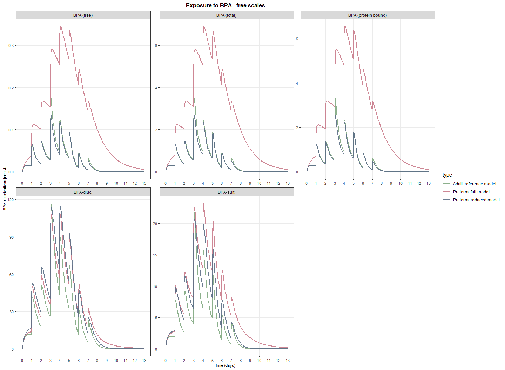<!-- -->

``` r
graph2svg(Concentration_BPA_free_scales, file = "D:/Michi/12_Plasticizer_Parenteral/Co_author_comments_03.26/Updated_Plots/BPA_model_free_scales_180326.svg", width = 6.2, height = 3.5)
```

    ## Exported graph as D:/Michi/12_Plasticizer_Parenteral/Co_author_comments_03.26/Updated_Plots/BPA_model_free_scales_180326.svg

``` r
ng_per_kg_BPA_free_scales <- ggplot(models_BPA_kg,
       aes(x = TIME / 24, y = `nmol/L`,
           colour = type, fill = type)) +
  geom_line(linewidth = 0.9, alpha = 0.9) +
  
  scale_colour_manual(values = type_cols) +
  scale_fill_manual(values = type_cols) +
  
  scale_x_continuous(
    breaks = seq(0, ceiling(max(models_BPA_kg$TIME / 24)), by = 1)
  ) +
  labs(
    x = "Time (days)",
    y = "BPA + derivatives [ng/kg]",
    title = "Exposure to BPA - free scales"
  ) +
  theme_bw() +
   facet_wrap(
    . ~ Output,
    labeller = labeller(Output = output_labs_BPA_kg), scales = "free"
  ) +
 theme(
    panel.grid.major = element_line(linewidth = 0.3),
    panel.grid.minor = element_blank(),
    
    axis.text.x  = element_text(size = 8),
    axis.text.y  = element_text(size = 8),
    axis.title.x = element_text(size = 8),
    axis.title.y = element_text(size = 8),
    plot.title   = element_text(size = 12, face = "bold", hjust = 0.5),
    axis.line    = element_line(linewidth = 0.4)
  )

graph2svg(ng_per_kg_BPA_free_scales, file = "D:/Michi/12_Plasticizer_Parenteral/Co_author_comments_03.26/Updated_Plots/ng_per_kg_BPA_model_free_scales_180326.svg", width = 6.4, height = 4.7)
```

    ## Exported graph as D:/Michi/12_Plasticizer_Parenteral/Co_author_comments_03.26/Updated_Plots/ng_per_kg_BPA_model_free_scales_180326.svg

``` r
models_BPA_RIN <- models_BPA_kg %>% dplyr::filter(Output == "Rin1" | Output == "Rin2") %>% dplyr::filter(type != "Preterm: full model")

RIN_BPA <- ggplot(models_BPA_RIN,
       aes(x = TIME / 24, y = `nmol/L`,
           colour = Output, fill = Output)) +
  geom_line(linewidth = 0.9, alpha = 0.9) +
  
  scale_colour_manual(values = c("Rin1" = "#88A0C6","Rin2" = "#D8C6A0"), labels = c("Rin1" = "Aqueous mixture", "Rin2" = "Lipid mixture")) +
  scale_fill_manual(values = c("Rin1" = "#88A0C6","Rin2" = "#D8C6A0"), labels = c("Rin1" = "Aqueous mixture", "Rin2" = "Lipid mixture")) +
  scale_x_continuous(
    breaks = seq(0, ceiling(max(models_BPA_RIN$TIME / 24)), by = 1)
  ) +
  labs(
    x = "Time (days)",
    y = "nmol/h",
    title = "Rin BPA"
  ) +
  theme_bw() +
   facet_wrap(
    . ~ type, scales = "free",
    labeller = labeller(type = c(
      "Adult: reference model" = "Adult BPA Exposure",
      "Preterm: reduced model" = "Preterm BPA Exposure"
    ))
  ) +
 theme(
    panel.grid.major = element_line(linewidth = 0.3),
    panel.grid.minor = element_blank(),
    
    axis.text.x  = element_text(size = 8),
    axis.text.y  = element_text(size = 8),
    axis.title.x = element_text(size = 8),
    axis.title.y = element_text(size = 8),
    plot.title   = element_text(size = 12, face = "bold", hjust = 0.5),
    axis.line    = element_line(linewidth = 0.4)
  )


print(RIN_BPA)
```

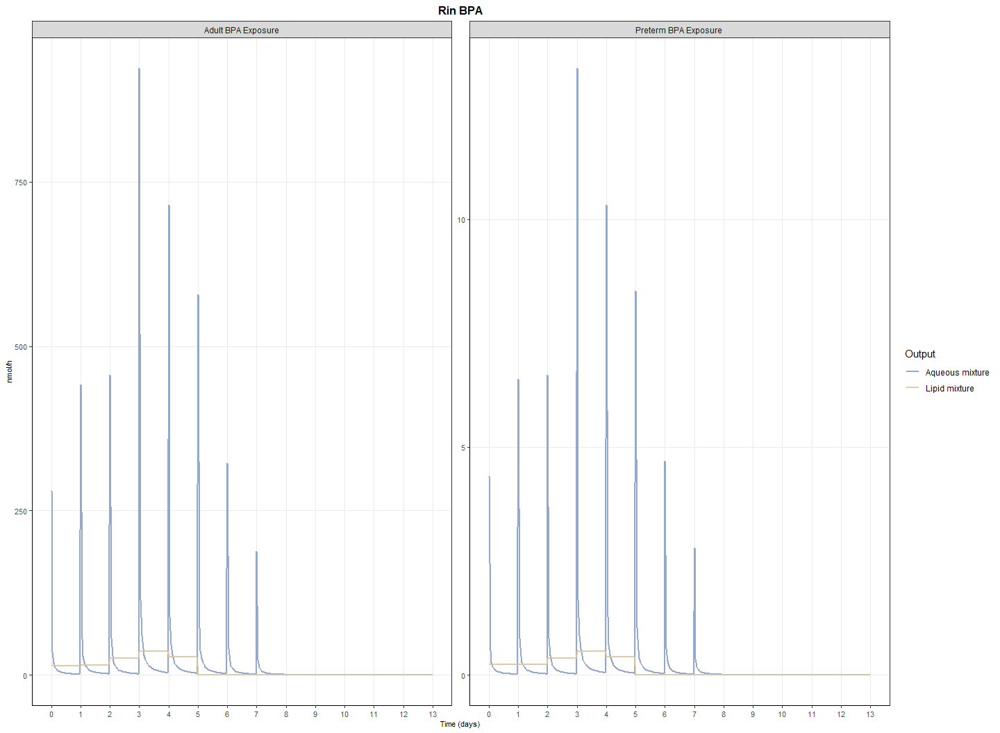<!-- -->

``` r
graph2svg(RIN_BPA, file = "D:/Michi/12_Plasticizer_Parenteral/Co_author_comments_03.26/Updated_Plots/RIN_BPA_180326.svg", width = 5, height = 2.2)
```

    ## Exported graph as D:/Michi/12_Plasticizer_Parenteral/Co_author_comments_03.26/Updated_Plots/RIN_BPA_180326.svg

``` r
rm(output_order, compound_levels)
```
